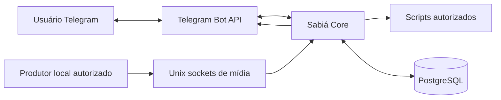

# A-Bioma Sabiá

**Ponte planejada entre usuários do Telegram e operações locais autorizadas do ecossistema A-Bioma.** O Sabiá centraliza autorização, roteamento, processamento assíncrono, alertas e entrega de mensagens ou arquivos, sem oferecer execução arbitrária de comandos remotos.

> **Estado em 03/11/2026:** documentação em refinamento; gate do MVP **BLOCKED**. A branch `develop` ainda **não contém código-fonte em `/src`**. Tecnologias, fluxos e comandos abaixo são **decisões ou propostas documentais, não funcionalidades já executáveis**.

## O que o projeto pretende oferecer

- **Telegram:** clientes lógicos isolados, catálogo de ações e menus sujeitos a autorização por usuário e chat.
- **Operações locais:** encaminhamento apenas para scripts/processadores previamente cadastrados, com controle de argumentos.
- **Trabalho assíncrono:** jobs, acompanhamento de estado, verificações agendadas e alertas.
- **Mídia:** recebimento local por Unix sockets e entrega correlacionada ao destino Telegram, com persistência antes da confirmação.

## Tecnologias e responsabilidades previstas

| Tecnologia | Responsabilidade no desenho |
|---|---|
| Go | Serviço `sabia`, pretendido como binário único |
| Debian Linux / systemd | Execução supervisionada sob usuário de serviço, sem root |
| Telegram Bot API (HTTPS) | `getUpdates` por long polling e envio de respostas |
| PostgreSQL | Estado operacional, filas, histórico e mídia |
| Unix domain sockets + MessagePack | Ingestão local de arquivos integrais e fracionados |
| Bash / JSON Lines | Processadores iniciais cadastrados e eventos de progresso |

## Arquitetura em uma visão

**Exemplo de interação especificada (ainda não disponível):** a pessoa envia `/start` ao bot, vê um menu de ações permitidas, seleciona uma ação cadastrada e recebe mensagem de progresso ou resultado. O cadastro de contato não concede automaticamente acesso a operações restritas.

## Documentação

| Assunto | Documento |
|---|---|
| Requisitos e situação da instalação | [Instalação](docs/instalacao.md) |
| Navegação e exemplos no Telegram | [Guia do usuário](docs/guia-usuario.md) |
| Dados e relacionamentos planejados | [Persistência](docs/persistencia.md) |
| Telegram, sockets, CLI e demais integrações | [Interfaces e serviços](docs/interfaces-servicos.md) |
| Especificações técnicas dos envelopes | [Referência de contratos](docs/referencia-contratos.md) |
| Identidades, permissões e autorização | [Segurança e acessos](docs/seguranca-acessos.md) |
| Componentes e fluxos | [Arquitetura](docs/arquitetura.md) |
| Índice técnico completo | [Documentação existente](docs/README.md) |
| Bloqueios em aberto | [Pendências do MVP](docs/pendencias.md) |

## Limitações atuais

Não existem binário, CLI, sockets, interface Telegram ou testes executáveis confirmados nesta branch. Caminhos definitivos dos sockets, configuração completa do PostgreSQL e contratos de comandos continuam pendentes. Os casos T01–T05 são **planos de teste**, não evidência de execução. Consulte o [estado dos testes](docs/testes/telegram/README.md) e as [pendências](docs/pendencias.md).

O material de Charter, Scope, ADRs, especificações, Implementation e backups históricos foi preservado sob `/docs`.
