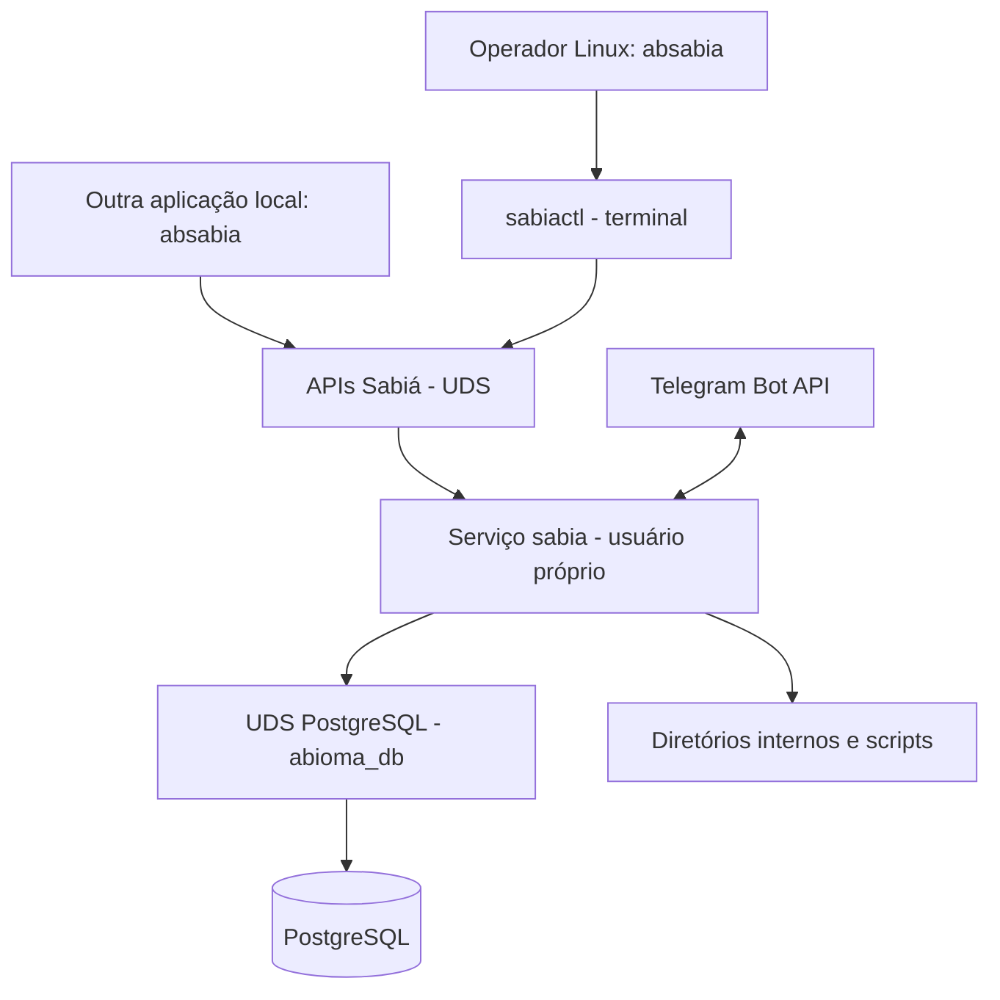

# A-Bioma Sabiá

**Serviço Linux planejado para integrar clientes Telegram e aplicações locais com operações autorizadas do A-Bioma.** O Sabiá centralizará as regras de negócio e a persistência PostgreSQL. Usuários e aplicações locais se comunicarão com o serviço exclusivamente por APIs em Unix domain sockets (UDS).


> **Situação em 03/11/2026:** arquitetura em especificação; o gate do MVP permanece **BLOCKED**. A branch `develop` não contém `/src`, binário, sockets executáveis ou `sabiactl`. Os recursos abaixo são **requisitos planejados**, não implementação concluída.

## Capacidades previstas

- **Serviço `sabia`:** gerenciar conexões, regras de negócio, registros, menus, catálogo de ações, scripts cadastrados, jobs, alertas, mídia e integração com Telegram.
- **PostgreSQL:** manter os dados persistentes e o estado operacional, com conexão do serviço **somente por UDS**.
- **APIs do serviço por UDS:** receber consultas, testes, configurações, operações sobre menus e scripts e uploads autorizados de arquivos.
- **`sabiactl`:** aplicação de terminal com telas navegáveis, indicadores, testes de conectividade e administração, usando apenas sockets do Sabiá.
- **Telegram:** oferecer ações permitidas a clientes/usuários autorizados, sem execução remota de shell arbitrário.


## Arquitetura



As regras de isolamento, usuários Linux e permissões dos sockets estão em [Segurança e acessos](docs/arquitetura/ARQ-006-seguranca-autorizacao.md).

## `sabiactl`: interface administrativa planejada

O `sabiactl` será disponibilizado para operadores locais autorizados. O terminal terá menus, cores e mensagens compreensíveis, com navegação e opções para voltar ou sair.

```text
SABIÁ — Painel de administração              [TELA PROPOSTA]

Estado do serviço: —       Conexões UDS ativas: —
Sessões administrativas: — Contatos Telegram: —
Clientes configurados: —   Processadores: —

1. Consultar estado e conexões
2. Ver usuários, clientes e serviços configurados
3. Executar testes de conectividade e operação
4. Gerenciar menus e ações
5. Consultar ou alterar configurações
6. Enviar, validar e incorporar scripts
0. Sair

Escolha: _
```

Os traços não representam valores reais. **Conexões UDS ativas**, **sessões locais**, **contatos Telegram cadastrados** e **serviços/clientes configurados** são indicadores distintos; não se deve apresentar contatos Telegram como usuários permanentemente conectados.

### Envio e incorporação de scripts

O operador selecionará um arquivo no `sabiactl`, que enviará o conteúdo pela API UDS. **O serviço** validará identidade, tamanho, integridade, nome e formato e gravará em uma pasta interna controlada. A incorporação ou ativação será uma operação separada e autorizada; upload não significa autorização automática para executar o script. O usuário não fornecerá um caminho arbitrário de escrita no servidor.

## Documentação

| Assunto | Documento |
|---|---|
| Requisitos de implantação | [Instalação](docs/guias/GUIA-001-preparar-instalacao.md) |
| Criar e configurar um bot do Telegram | [Criar bot no Telegram](docs/guias/GUIA-002-criar-bot-telegram.md) |
| Telas do `sabiactl` e do Telegram | [Guia do usuário](docs/guia-usuario.md) |
| Dados e tabelas PostgreSQL | [Persistência](docs/persistencia/readme.md) |
| APIs UDS e contratos | [Interfaces e serviços](docs/arquitetura/ARQ-011-inventario-canais-servicos.md) |
| Contratos técnicos existentes | [Referência de contratos](docs/contratos/README.md) |
| Contas Linux, grupos e segurança | [Segurança e acessos](docs/arquitetura/ARQ-006-seguranca-autorizacao.md) |
| Fluxos e componentes | [Arquitetura](docs/arquitetura.md) |
| Acervo completo | [Documentação técnica](docs/README.md) |
| Bloqueios atuais | [Pendências](docs/referencia/REF-006-gate-mvp.md) |

## Limitações e decisões pendentes

Ainda faltam implementar os dois executáveis, as APIs administrativas, o protocolo de `sabiactl`, o fluxo de scripts e a configuração efetiva do PostgreSQL por UDS. Os contratos antigos de mídia citam o grupo `abioma`; o novo desenho solicitado adota **`absabia`**, divergência que deverá ser reconciliada na especificação. Nomes definitivos de sockets, esquemas de autorização, contagens e telas também permanecem pendentes.
