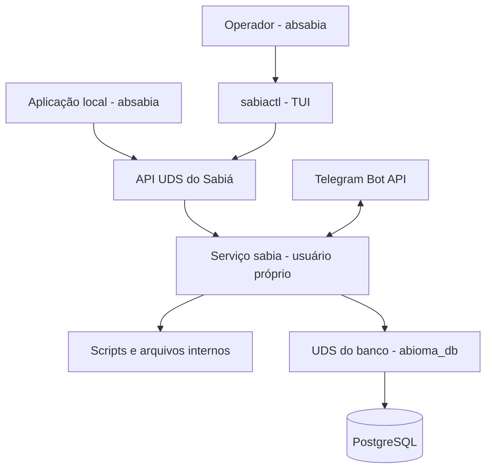
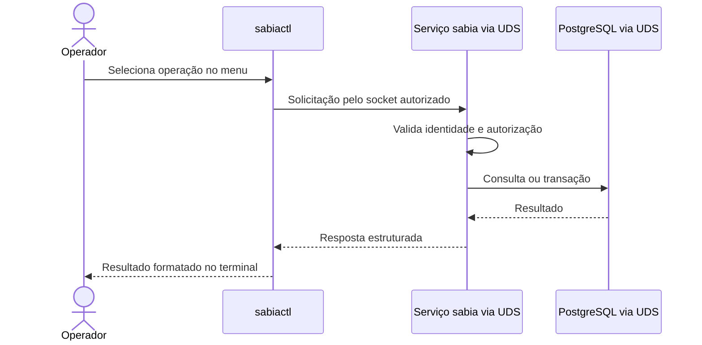

# Arquitetura — serviço Sabiá e administração local

> **Nova diretriz planejada**, sem implementação em `/src`. Complementa os desenhos e especificações já existentes, que continuam preservados.

## Componentes e canais

| Componente | Responsabilidade |
|---|---|
| `sabia` | Processo systemd isolado; regras de negócio, persistência, autorização e Telegram |
| `sabiactl` | Interface humana de terminal; comunica somente com API UDS |
| APIs UDS do Sabiá | Status, conexões, testes, catálogo, menus, configurações e uploads |
| UDS PostgreSQL | Canal exclusivo do serviço para o banco, protegido por `abioma_db` e autenticação SQL |
| Processadores | Scripts previamente cadastrados, sem shell remoto arbitrário |

## Sequência de uma operação administrativa

## Scripts e configuração

O `sabiactl` enviará arquivos de scripts e solicitará alterações de configuração por sockets. O serviço fará toda validação, armazenamento interno e persistência, sem que o usuário tenha acesso direto ao banco ou às pastas de execução. **Upload, validação e ativação** devem constituir etapas distintas; regras finais de revisão e autorização ainda estão em aberto.

## Indicadores previstos

O painel deverá diferenciar: conexões UDS ativas, sessões administrativas locais, contatos Telegram conhecidos/autorizados, clientes Telegram configurados e processadores/serviços cadastrados. Contatos Telegram não equivalem a conexões ativas ao daemon.

## Referências

- [Contexto do sistema](arquitetura/ARQ-001-contexto-sabia.md)

- [Componentes do Core](arquitetura/ARQ-002-componentes-core.md)
- [Fluxo Telegram](especificacao/fluxos/comando-telegram.md)
- [Interfaces e contratos UDS](interfaces-servicos.md)
- [Segurança e grupos Linux](seguranca-acessos.md)
- [Persistência PostgreSQL](persistencia/readme.md)
- [Pendências de refinamento](pendencias.md)
