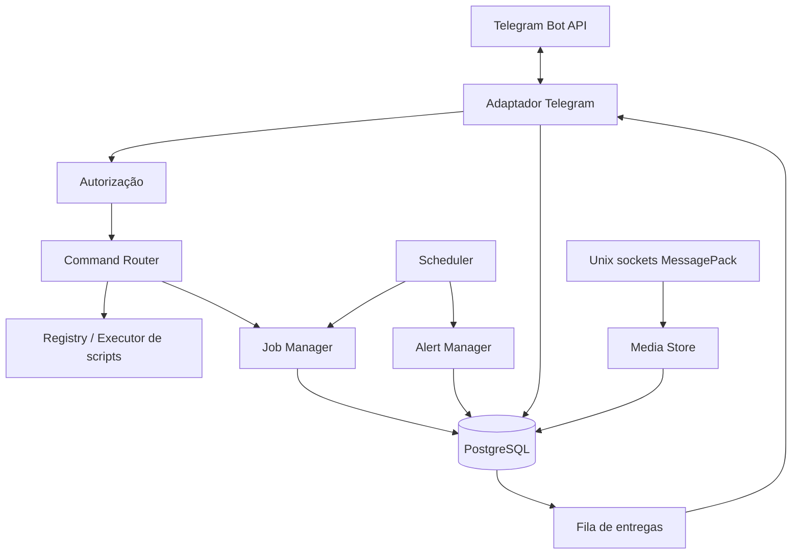
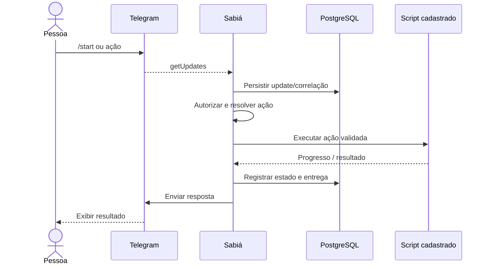

# Arquitetura — visão de entrada

> Esta página resume o **desenho documental** do Sabiá. O diagrama não representa componentes em execução: a branch `develop` não tem `/src`.

## Componentes e responsabilidades previstos

| Área | Responsabilidade documental |
|---|---|
| Adaptador Telegram | Recepção por long polling e tradução de updates |
| Autorização/Router | Restringir identidades e localizar comandos cadastrados |
| Scripts e processadores | Executar apenas alvos autorizados, reportar progresso |
| Jobs/Scheduler/Alert Manager | Assincronia, verificações e notificação por mudança de estado |
| PostgreSQL | Persistir entradas, requisições, jobs, saídas, alertas e mídia |
| Sockets de mídia | Receber arquivo integral/fracionado e correlacionar por `request_id` |

## Fluxo de comando previsto

A sequência é **intencional e simplificada**. Idempotência, transações, estados de jobs, recuperação após falha e formatos são tratados nos documentos detalhados. O fluxo de mídia usa sockets independentes da entrada Telegram.

## Fontes e bloqueios

- [Desenho dos componentes — DSG-0002](desenho/componentes-core.md)
- [Desenho de contexto — DSG-0001](desenho/contexto-sabia.md)
- [Decisões arquiteturais (ADRs)](README.md)
- [Implementation proposta](implementation/README.md)
- [Pendências que bloqueiam o MVP](pendencias.md)
