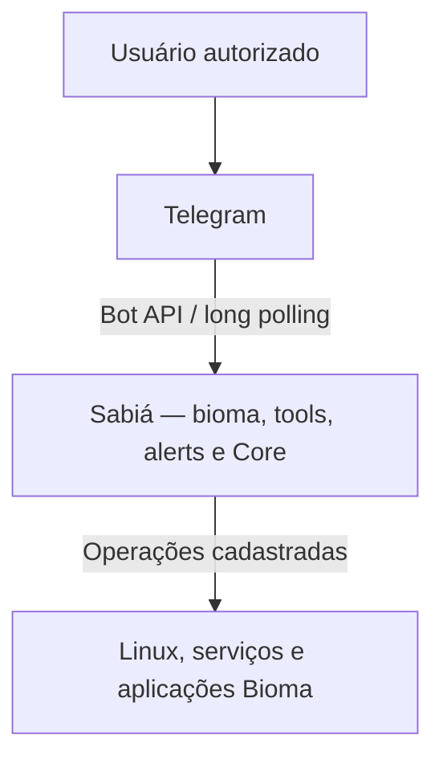

<!-- A-BIOMA-DOC-STANDARD -->
<!-- A-BIOMA-DOC-REVISADO -->

# ARQ-001 — Contexto do Sabiá

**ID:** `ARQ-001` · **Origem:** `DSG-0001` · **Estado histórico do desenho:** `finalized`  
**Implementação:** não verificada; documentação conceitual

## Objetivo

Representar o Sabiá no contexto do Telegram, dos usuários autorizados e do ambiente Linux/Bioma.

## Visão de arquitetura

**Nível C4 declarado na origem:** `System Context`. O desenho descreve componentes conceituais, não prova de implantação.

## Diagrama

## Elementos e responsabilidades

- **Usuário autorizado:** inicia consultas e operações permitidas.
- **Telegram:** transporte externo das mensagens e arquivos.
- **Sabiá:** aplica autorização, roteia comandos, executa jobs, agenda verificações e produz alertas.
- **Linux/Bioma:** ambiente local no qual existem scripts, serviços e aplicações integradas.

## Relações relevantes

- o Telegram não recebe acesso a shell arbitrário;
- clientes Telegram mantêm autorização e catálogo próprios;
- o Sabiá inicia a comunicação necessária com a Bot API no modo long polling;
- integrações locais são acessadas por executores e interfaces do Core.

## Critérios de validação documental

- fronteiras externas estão identificadas;
- não existe dependência do Core em bot específico;
- a ausência de porta pública para webhook está representada.

## Dependências

- [ADR-0002 — Múltiplos clientes Telegram isolados](../decisoes/DEC-002-clientes-telegram-isolados.md)
- [ADR-0003 — Core independente do Telegram](../decisoes/DEC-003-core-independente-telegram.md)
- [ADR-0005 — Telegram Long Polling](../decisoes/DEC-005-telegram-long-polling.md)
- [ADR-0008 — Menor privilégio e autorização explícita](../decisoes/DEC-008-menor-privilegio-autorizacao.md)

## Limitações e pendências

Desenho conceitual: os três clientes Telegram são previstos, mas não há serviço implementado ou teste de integração comprovado nesta branch. A administração local por UDS é descrita separadamente em [arquitetura do serviço](../arquitetura.md).

## Rastreabilidade

[DSG-0001 — desenho original](https://github.com/ahhvahh/a-bioma-sabia/blob/f898239c4519b1c8fd21327adf7a8407a1bbeaf7/docs/desenho/contexto-sabia.md). A versão original mantém o diagrama textual, preservado para comparação histórica.
