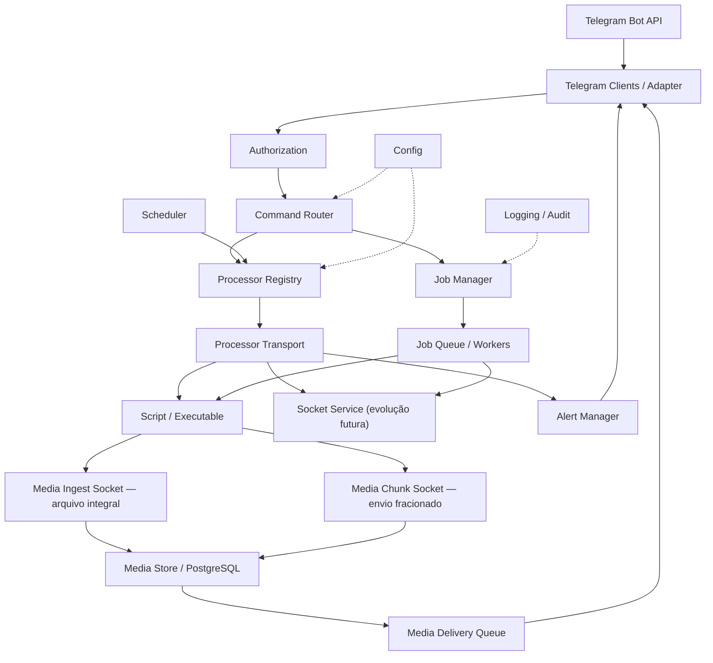

<!-- A-BIOMA-DOC-STANDARD -->
<!-- A-BIOMA-DOC-REVISADO -->

# ARQ-002 — Componentes do Sabiá Core

**ID:** `ARQ-002` · **Origem:** `DSG-0002` · **Estado histórico do desenho:** `finalized`  
**Implementação:** não verificada; documentação conceitual

## Objetivo

Representar os componentes necessários ao primeiro MVP e suas responsabilidades principais.

## Visão de arquitetura

**Nível C4 declarado na origem:** `Component`. O desenho descreve componentes conceituais, não prova de implantação.

## Diagrama

## Elementos e responsabilidades

- **Telegram Clients/Adapter:** long polling, tradução de updates e envio/edição de mensagens.
- **Authorization:** valida usuário e, quando configurado, chat.
- **Command Router:** resolve identificadores de comandos internos.
- **Processor Registry:** no MVP associa identificadores permitidos a scripts Bash cadastrados; aplicações dedicadas e serviços/socket são evolução futura conforme ADR-0011.
- **Processor Transport:** no MVP adapta a execução do script Bash ao protocolo CTR-0005, com `request_id` em stdin e eventos JSON Lines em stdout.
- **Job Manager/Queue/Workers:** executa operações demoradas fora do tratamento imediato do comando, preserva `request_id` e encaminha eventos de progresso/finalização.
- **Media Ingest Socket:** recebe arquivos integrais de até 20 MB por Unix socket e MessagePack.
- **Media Chunk Socket:** recebe arquivos maiores em chunks persistidos de até 5 MB.
- **Media Store/PostgreSQL:** persiste metadados e BLOBs antes do ACK ao produtor.
- **Media Delivery Queue:** mantém transmissões pendentes por `media_id` e permite recovery após restart.
- **Scheduler:** dispara verificações cadastradas.
- **Alert Manager:** avalia mudança de estado e decide quando notificar.
- **Config:** carrega configuração sem tokens reais versionados.
- **Logging/Audit:** produz registros estruturados sem segredos.

## Relações relevantes

O Command Router não conhece detalhes de Telegram, shell, socket, FFmpeg ou outra ferramenta concreta. Processadores entram pelo Processor Registry e são acessados pela camada Processor Transport. Conteúdo binário entra por Media Ingest, é persistido por `media_id` e só depois é encaminhado ao transporte externo.

## Critérios de validação documental

- responsabilidades do MVP estão separadas;
- componentes de transporte, domínio operacional e execução não estão fundidos;
- o Processor Transport separa protocolo interno de mecanismos concretos de execução/comunicação;
- o canal de controle e o canal de mídia são separados;
- os caminhos normativos dos sockets e demais parâmetros ainda em refinamento não alteram este desenho estrutural.

## Dependências

- [ADR-0001 — Go, binário único e serviço Linux](../decisoes/DEC-001-go-binario-unico-linux.md)
- [ADR-0002 — Múltiplos clientes Telegram isolados](../decisoes/DEC-002-clientes-telegram-isolados.md)
- [ADR-0003 — Core independente do Telegram](../decisoes/DEC-003-core-independente-telegram.md)
- [ADR-0004 — Registro explícito de scripts](../decisoes/DEC-004-registro-explicito-scripts.md)
- [ADR-0005 — Telegram Long Polling](../decisoes/DEC-005-telegram-long-polling.md)
- [ADR-0006 — Jobs assíncronos](../decisoes/DEC-006-jobs-assincronos.md)
- [ADR-0007 — Scheduler e alertas orientados a estado](../decisoes/DEC-007-alertas-estado.md)
- [ADR-0008 — Menor privilégio e autorização explícita](../decisoes/DEC-008-menor-privilegio-autorizacao.md)
- [ADR-0011 — Processadores assíncronos registrados e transporte de progresso](../decisoes/DEC-011-processadores-assincronos-registrados.md)
- [ADR-0012 — Ingestão persistente de mídia por Unix socket](../decisoes/DEC-012-ingestao-midia-socket-messagepack.md)
- [ADR-0013 — Dois canais de ingestão de mídia e upload fracionado](../decisoes/DEC-013-ingestao-midia-fracionada.md)

## Limitações e pendências

O desenho representa componentes planejados. O canal por socket dedicado a processadores distintos de Bash é evolução futura, não implementação do MVP. Os limites de mídia e os grupos Linux devem seguir os contratos atualizados; consulte [DEC-013](../decisoes/DEC-013-ingestao-midia-fracionada.md) e [segurança](../seguranca-acessos.md).

## Rastreabilidade

[DSG-0002 — desenho original](../desenho/componentes-core.md). A versão original mantém o diagrama textual, preservado para comparação histórica.
