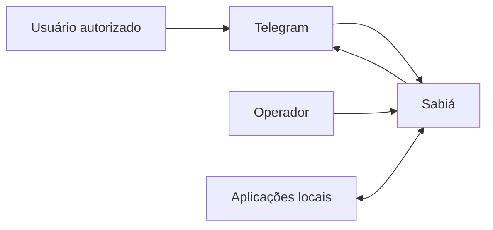
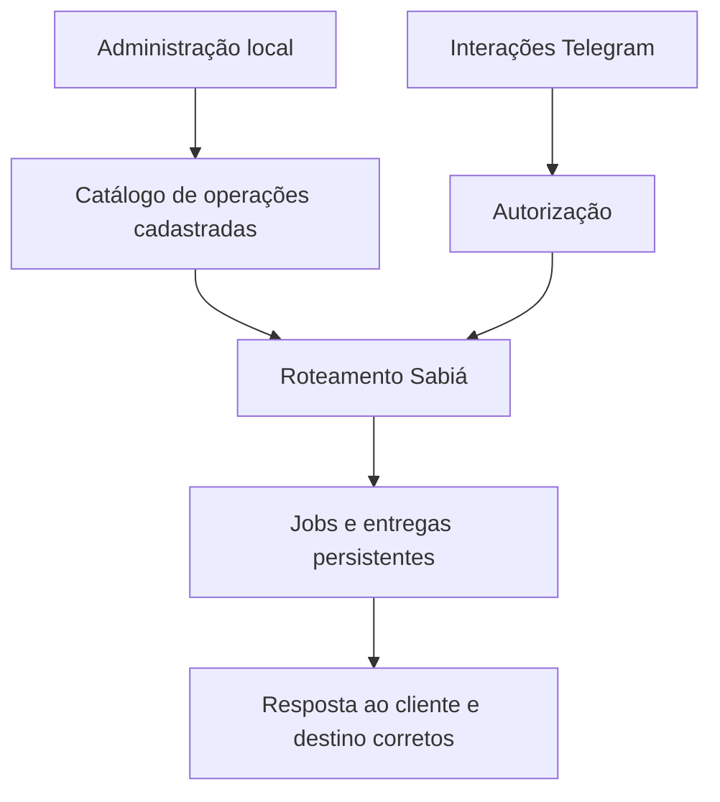

# Sabiá — Charter do projeto

  

## Resumo executivo

O Sabiá intermedeia solicitações autorizadas dos clientes Telegram e serviços locais do ecossistema Bioma, com catálogo de ações, processamento assíncrono, persistência operacional, alertas e transporte de mídia.

## Propósito do projeto

| Campo | Declaração |
|---|---|
| **Problema** | Aplicações locais precisam expor operações e alertas sem shell remoto arbitrário, portas públicas ou dependência direta de credenciais Telegram. |
| **Propósito** | Oferecer uma ponte segura entre usuários autorizados e operações previamente cadastradas, preservando o estado operacional e o destino das respostas. |
| **Beneficiários** | Usuários Telegram autorizados, operadores da instalação e serviços locais integrados. |
| **Valor esperado** | Operação controlada, rastreável e recuperável, com baixo acoplamento aos canais externos. |

## Visão geral

O Sabiá controla a autorização, o catálogo, o estado de jobs e o destino de retorno; a lógica de negócio permanece nas aplicações acionadas.

## Contexto de responsabilidades

O diagrama descreve responsabilidades de alto nível, não define tabelas, transportes, interfaces ou filas.

## Tecnologias previstas e evidências

| Tecnologia | Papel | Situação | Evidência |
|---|---|---|---|
| Telegram Bot API | Canal remoto inicial | Previsto; condições de implantação pendentes | [CON-002](conditions/CON-002-o-primeiro-canal-telegram-recebe-updates-por-long-polling-e-.md), [DSC-001](discovery/telegram-bot-api/DSC-001-viabilidade-da-telegram-bot-api.md) |
| Linux / systemd | Execução do serviço | Previsto; ambiente ainda depende de validação | [CON-001](conditions/CON-001-o-servico-opera-em-linux-e-o-executavel-principal-e-distribu.md), [DSC-003](discovery/debian-systemd/DSC-003-viabilidade-do-servico-linux.md) |
| PostgreSQL | Persistência oficial | Previsto; compatibilidade da instalação pendente | [CON-005](conditions/CON-005-postgresql-e-a-persistencia-oficial-do-estado-operacional-se.md), [DSC-002](discovery/postgresql/DSC-002-viabilidade-do-postgresql.md) |
| Go | Linguagem planejada | Evidência em decisão técnica preexistente; não é requisito criado pelo Charter | Etapa de Implementation, sem link legado |

## Responsabilidades e limites

O Sabiá recebe comandos de clientes habilitados, registra contatos e catálogo persistentes, aplica autorização, encaminha operações conhecidas, acompanha jobs e notificações, preserva entregas após falhas e permite publicação de eventos assinados.

Não oferece shell arbitrário, webhook público no primeiro MVP, canais remotos adicionais, processadores multimídia complexos nem acesso direto de aplicações ao banco ou diretórios internos. A execução principal não usa root.

Assinaturas por evento foram aprovadas em 21/10/2026; mailings periódicos seguem em backlog. O limite revisto do canal de mídia fracionada é de 50.000.000 bytes.

## Navegação

- [Contexto e atores PCH/ACT](project-context/README.md)
- [Objetivos OBJ](objectives/README.md)
- [Não objetivos NOBJ](non-objectives/README.md)
- [Condições CON/ASM](conditions/README.md)
- [Questões abertas OPEN](open-questions/README.md)
- [Discovery DSC](discovery/README.md)
- [Progresso e dependências](CONTINUIDADE.md)

## Situação do gate

`BLOCKED` — os documentos continuam em `refinement` e os DSC ainda não são conclusivos. A migração não promove status nem libera Scope automaticamente.
