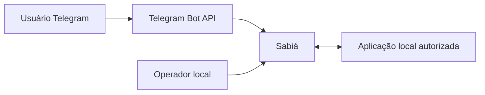

# PCH-001 — Contexto e atores do Sabiá

  

## Problema e fronteira

Aplicações locais precisam permitir operações autorizadas e publicar resultados sem expor shell arbitrário ou serviços públicos. Sabiá atua como intermediário entre participantes Telegram e aplicações do ambiente; sistemas acionados conservam sua lógica de negócio.

## ACT-001 — Usuário do Telegram

- **Papel:** solicitante e destinatário de informações.
- **Interesse:** executar ações permitidas, visualizar menus, acompanhar jobs e receber alertas.
- **Interações:** inicia `/start` e outras operações registradas; recebe mensagens e eventos autorizados.
- **Limites:** cadastro de contato não concede automaticamente autorização; não pode cadastrar caminhos executáveis.

## ACT-002 — Operador do Sabiá

- **Papel:** administração local.
- **Interesse:** instalar e configurar clientes, permissões, catálogo e agendamentos.
- **Interações:** CLI local e administração do serviço Linux.
- **Limites:** regras do menor privilégio; não transforma Telegram em ferramenta de configuração privilegiada.

## ACT-003 — Aplicação ou serviço local autorizado

- **Papel:** produtor ou consumidor de operações e mídia.
- **Interesse:** integração sem conhecer tokens nem destinatários do Telegram.
- **Interações:** interfaces locais autorizadas do Sabiá.
- **Limites:** não acessa diretamente banco ou diretórios internos do serviço.

## Stakeholder sem ator designado

Responsável formal de aprovação ainda depende de [OPEN-001](../open-questions/OPEN-001-autoridade-formal-de-aprovacao.md). Não atribuir arbitrariamente um ACT novo.

## Visão contextual

O diagrama representa apenas contexto; fluxos e contratos técnicos ficam no Scope.
