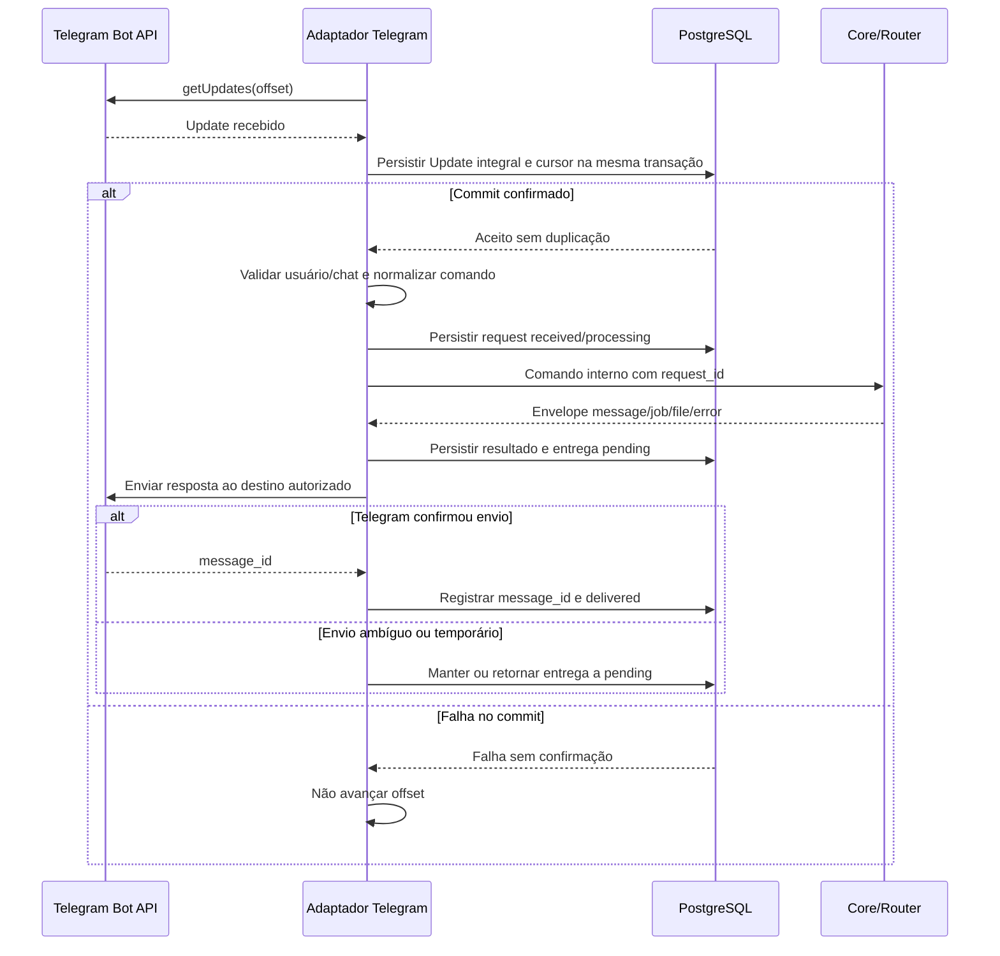

<!-- A-BIOMA-DOC-STANDARD -->
<!-- A-BIOMA-DOC-REVISADO -->

# FLUX-001 — Comando Telegram

**ID:** `FLUX-001` · **Origem histórica:** `FLW-0001`  
**Estado da especificação:** `refinement` · **Versão aprovada:** nenhuma  
**Implementação e testes executáveis:** não verificados nesta branch.

## Objetivo

Processar um comando recebido por um cliente Telegram até sua resposta, preservando autorização e isolamento.

## Dependências

- [MOD-0002 — Adaptador Telegram](../especificacao/modulos/telegram.md)
- [MOD-0006 — Segurança e autorização](../arquitetura/ARQ-006-seguranca-autorizacao.md)
- [MOD-0001 — Core e Command Router](../arquitetura/ARQ-003-core-command-router.md)
- [CONTR-001 (CTR-0001) — Comando interno](../contratos/CONTR-001-comando-interno.md)
- [PST-0003 — Claim concorrente de filas persistentes](../persistencia/concorrencia.md)
- [CONTR-006 (CTR-0006) — Mídia persistida](../contratos/CONTR-006-midia-persistida.md)

## Gatilho

Update recebido por long polling em cliente habilitado.

## Pré-condições

- cliente habilitado;
- token disponível por fonte permitida;
- update pertence ao cliente correto.

## Diagrama de sequência — comportamento documentado

## Fluxo principal

1. o adaptador recebe update;
2. identifica usuário, chat, comando e mídia/anexos relevantes;
3. persiste transacionalmente o update e sua correlação com o cliente usando `update_id` como chave idempotente;
4. somente após a persistência bem-sucedida, o ciclo de polling pode avançar para `offset = maior update_id persistido + 1`;
5. a autorização valida whitelist do cliente e, quando configurado, chat;
6. o adaptador solicita ao Sabiá a geração de `request_id` UUID v4, persiste a request em `received`, persiste a mídia recebida conforme CTR-0006, normaliza anexos por `media_id`, define `principal_id`, `client_id`, `received_at` e `reply_context`, tokeniza os argumentos e constrói o comando interno sem aplicar validação semântica específica da operação;
7. antes de entregar ao Core, a request muda para `processing`; o Command Router resolve a operação cadastrada e a operação valida quantidade, formato e domínio dos argumentos;
8. a operação retorna envelope conforme CTR-0001 com `type`, `request_id` e `payload`; resultado `message`, `job` ou `file` conclui a request como `completed`, enquanto resultado `error` conclui a request como `failed`;
9. o adaptador converte `message`, `job` ou `error` para resposta Telegram; resultados `file` usam `media_id` de CTR-0006;
10. o adaptador persiste a resposta como entrega `pending`;
11. o adaptador envia a resposta pelo Telegram;
12. após sucesso da Bot API, persiste o `message_id` retornado e marca a entrega como `delivered`;
13. auditoria registra a operação sem segredos.

## Fluxos alternativos

### Falha temporária de leitura por getUpdates

1. timeout de transporte, falha de rede ou resposta `5xx` não altera o `offset`;
2. o cliente aplica backoff exponencial `1s → 2s → 4s → 8s → 16s → 30s`;
3. nova falha temporária avança uma etapa até o máximo de `30s`;
4. uma leitura bem-sucedida, ainda que sem updates, reseta o backoff para `1s`;
5. se o Telegram retornar `429` com `retry_after`, o cliente aguarda pelo menos o intervalo informado antes da próxima leitura;
6. falhas e backoff de um cliente não interferem nos demais.

### Falha de autenticação ou autorização no polling

1. erro de autenticação/autorização, incluindo `401` ou `403`, suspende o polling daquele cliente;
2. o erro é registrado para observabilidade;
3. os demais clientes continuam operando;
4. nenhuma alteração de `offset` ocorre.

### Falha antes da persistência do update

1. o update não é considerado aceito;
2. o `offset` não avança além desse `update_id`;
3. uma leitura posterior pode receber novamente o update.

### Update já persistido

1. o adaptador identifica a duplicidade pelo `update_id` dentro do cliente correspondente;
2. nenhuma segunda execução da mesma requisição é criada;
3. o estado local já existente continua sendo a fonte para processamento ou recovery.

### Retry de envio solicitado pelo Telegram

1. a entrega permanece `pending`;
2. se a resposta contiver `retry_after`, nenhuma nova tentativa pode ocorrer antes do intervalo informado;
3. depois do intervalo, a mesma entrega volta a ser elegível para envio.

### Falha temporária ou ambígua de envio

1. timeout, desconexão ou erro temporário sem confirmação retorna a entrega de `sending` para `pending`;
2. a aplicação registra a tentativa;
3. a entrega pode ser reenviada;
4. eventual duplicidade de mensagem é aceita para preservar semântica `at-least-once`.

### Falha permanente de envio

1. a entrega em `sending` é marcada como `failed`;
2. código e descrição do erro são preservados;
3. não há retry automático dessa entrega sem nova ação explicitamente definida.

### Restart com resposta pendente

1. respostas `sending` são reconciliadas para `pending` antes da retomada dos entregadores;
2. respostas `pending` retornam à etapa de claim/envio;
3. respostas `delivered` não são reenviadas;
4. respostas `failed` permanecem encerradas.

### Usuário ou chat não autorizado

1. a operação não chega ao executor;
2. a tentativa é registrada conforme política de auditoria.

### Comando desconhecido

1. o Router retorna erro controlado;
2. a request é concluída como `failed`;
3. nenhuma execução local ocorre.

## Falhas e tratamento

A entrega usa semântica `at-least-once`. Sucesso só é confirmado após retorno positivo da Bot API e persistência do `message_id`. Falha ambígua permanece pendente e pode resultar em duplicidade eventual.

A leitura por `getUpdates` usa backoff exponencial limitado a `30s` para falhas temporárias. `429` respeita `retry_after`; falhas de autenticação/autorização suspendem somente o cliente afetado. Nenhuma falha de polling altera o `offset`.

## Resultado

Resposta controlada ao usuário ou referência de job criado, com estado de entrega persistido.

## Critérios de aceite

- autorização antecede execução;
- comando interno possui `request_id`, `client_id`, `principal_id`, `reply_context` e `received_at` normalizados pelo adaptador;
- `reply_context.destination_id` representa o chat de resposta como string opaca ao Core;
- argumentos chegam ao Core como `string[]` já tokenizado pelo adaptador;
- validação semântica dos argumentos ocorre na operação correspondente;
- resultados `message`, `job` e `error` são convertidos pelo adaptador sem alterar sua semântica;
- resultado `error` preserva `code`, `message` e `retryable`;
- mídia recebida permanece correlacionada ao `request_id` e é persistida no PostgreSQL;
- referências internas de arquivo usam `media_id`;
- conteúdo binário nunca é registrado em logs;
- cliente não acessa comandos de outro cliente;
- falha antes da persistência não confirma o update;
- update persistido pode ser recuperado localmente após reinício;
- o mesmo `update_id` persistido para um cliente não gera execução duplicada;
- uma resposta não é `delivered` sem confirmação e persistência do `message_id`;
- `retry_after` impede retry antecipado;
- falha ambígua mantém a resposta pendente;
- falha temporária de polling usa backoff exponencial até `30s`;
- leitura bem-sucedida reseta o backoff para `1s`;
- `429` respeita `retry_after`;
- erro de autenticação/autorização suspende somente o cliente afetado;
- falha de polling não altera o `offset`.

## Implementação relacionada

Adaptador Telegram, segurança e Command Router.

## Emenda 2026-10-21 — aceite atômico e navegação

A sequência normativa inicia persistindo **Update JSON integral e recuperável**, chave única `(client_id, transport, update_id)` e avanço do cursor **em uma única transação**. Só após commit deve ocorrer a próxima leitura com offset avançado. O consumidor retoma no PostgreSQL e nunca executa novamente um update duplicado; registrar estados de consumo e reconciliar `processing` no restart. Essa regra substitui qualquer leitura da sequência acima que admita cursor avançado com payload não recuperável.

`/menu` e `/start` consultam a árvore de ações autorizadas e enviam teclado inline. Em `callback_query`, conferir usuário/chat, estado e permissões novamente; responder `answerCallbackQuery`; editar menu ou enviar novo menu caso a mensagem original não seja editável. `Voltar` navega ao pai, `Início` à raiz. Ações finais exigem validação pelo Router. Cliques forjados/antigos são recusados, e duplicatas não reexecutam operações.

## Rastreabilidade e limites

[Fonte histórica FLW-0001](../especificacao/fluxos/comando-telegram.md). Este diagrama descreve o fluxo **proposto/documentado**; não representa execução observada. Contratos, restrições e fluxos alternativos originais foram preservados na revisão.
