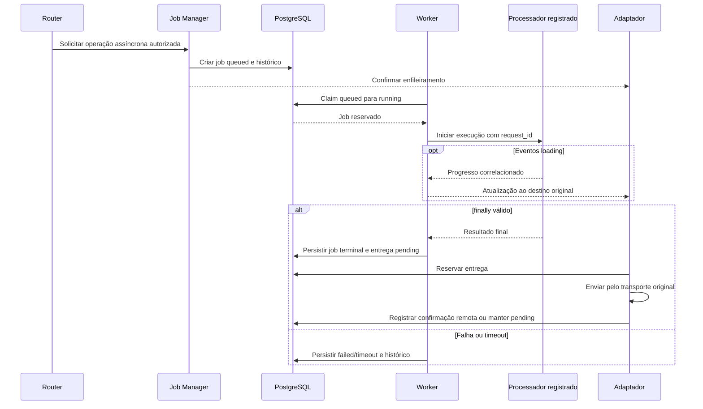

<!-- A-BIOMA-DOC-STANDARD -->
<!-- A-BIOMA-DOC-REVISADO -->

# FLUX-002 — Job assíncrono

**ID:** `FLUX-002` · **Origem histórica:** `FLW-0002`  
**Estado da especificação:** `refinement` · **Versão aprovada:** nenhuma  
**Implementação e testes executáveis:** não verificados nesta branch.

## Objetivo

Executar uma operação demorada sem bloquear novos comandos e entregar o resultado ao cliente e destino corretos.

## Dependências

- [MOD-0004 — Jobs](../arquitetura/ARQ-005-jobs.md)
- [CONTR-003 (CTR-0003) — Job](../contratos/CONTR-003-job.md)
- [DEC-009 (ADR-0009) — Persistência do estado operacional](../decisoes/DEC-009-postgresql-estado-operacional.md)
- [DEC-010 (ADR-0010) — Política de encerramento de jobs](../decisoes/DEC-010-encerramento-jobs.md)
- [MOD-0002 — Adaptador Telegram](../especificacao/modulos/telegram.md)
- [MOD-0007 — Processadores assíncronos e transporte](../arquitetura/ARQ-007-processadores-assincronos.md)
- [CONTR-005 (CTR-0005) — Protocolo de processador assíncrono](../contratos/CONTR-005-processador-assincrono.md)
- [CONTR-006 (CTR-0006) — Mídia persistida](../contratos/CONTR-006-midia-persistida.md)
- [CONTR-008 (CTR-0008) — Ingestão de mídia por Unix socket e MessagePack](../contratos/CONTR-008-ingestao-midia-messagepack.md)
- [CONTR-007 (CTR-0007) — Transmissão persistente de mídia](../contratos/CONTR-007-transmissao-midia.md)
- [PST-0003 — Claim concorrente de filas persistentes](../persistencia/concorrencia.md)

## Gatilho

Command Router identifica uma operação assíncrona válida.

## Pré-condições

- operação válida e autorizada;
- `request_id`, `client_id` e `reply_context` disponíveis;
- fila abaixo de `jobs.max_pending`.

## Diagrama de sequência — comportamento documentado

## Fluxo principal

1. Job Manager cria e persiste o job preservando `request_id`, `client_id` e `reply_context` da requisição de origem;
2. o job entra em `queued`;
3. o cliente envia confirmação imediata ao destino de origem;
4. enquanto houver slot de execução dentro do limite de threads lógicas de CPU disponíveis ao processo, um worker realiza o claim do próximo job e muda `queued → running`;
5. Worker delega a operação ao processador registrado quando aplicável;
6. eventos `loading` válidos são correlacionados por `request_id` e encaminhados pelo cliente correto;
7. mídias produzidas pelo processador são ingeridas por CTR-0008 e associadas ao mesmo `request_id` sem passar pelo canal de controle;
8. cada mídia persistida cria transmissão independente CTR-0007;
9. o job permanece `running` até receber `finally` válido ou atingir uma condição de falha/timeout;
10. `finally` produz o resultado final do processamento;
11. o resultado é persistido como resposta `pending`;
12. adaptador do `client_id` correspondente envia a resposta usando `reply_context.transport` e `reply_context.destination_id` persistidos;
13. após sucesso da Bot API, o identificador remoto da mensagem é persistido;
14. somente depois dessa persistência o estado de entrega passa para `delivered`.

## Fluxos alternativos

### Capacidade de execução ocupada

Quando a quantidade de jobs `running` atinge a quantidade de threads lógicas de CPU disponíveis ao processo, novos jobs aceitos permanecem `queued` até que um slot seja liberado.

### Fila cheia

Rejeitar a criação com erro controlado de capacidade.

### Restart com job queued

O job retorna à fila.

### Restart com job running

Marcar como `failed/service_restart`; não reexecutar automaticamente.

### Restart com resposta pendente

Resposta textual pendente volta à etapa de envio e segue semântica `at-least-once`.

Transmissões de mídia `pending` ou `transmitting` são recuperadas conforme CTR-0007. Se o `media_id` existir, a transmissão volta a ser elegível para envio; ausência da mídia gera `failed/media_missing`.

### Erro com retry_after

Retornar a resposta de `sending` para `pending` e tornar a próxima tentativa elegível somente depois do intervalo informado pelo Telegram.

### Falha permanente de entrega

Marcar a entrega em `sending` como `failed`, preservando código e descrição do erro. O estado final do processamento do job permanece separado do estado de entrega.

### Timeout do processador

Processadores CTR-0005 possuem timeout absoluto de 2 horas no MVP. Eventos `loading` não reiniciam o contador.

Se não houver `finally` válido até o limite, o worker solicita encerramento do transporte e o job realiza `running → timeout` com motivo `processor_timeout`.

Se o processo/transporte encerrar antes do prazo sem `finally`, o job termina em `failed` por falha de transporte.

### Cancelamento

Aplicar as regras de CTR-0003 conforme o estado atual.

## Falhas e tratamento

Falha de processamento e falha de entrega são registradas separadamente.

Uma resposta processada não é considerada entregue enquanto a Bot API não retornar sucesso e a confirmação remota não for persistida. Timeout, desconexão ou outro resultado ambíguo retorna a resposta de `sending` para `pending` e permite retry. A política privilegia eventual entrega sobre eliminação absoluta de duplicidades.

## Resultado

Job possui estado final persistido e sua resposta permanece rastreável até atingir `delivered` ou `failed`.

## Critérios de aceite

- fila respeita `jobs.max_pending` e concorrência não excede a quantidade de threads lógicas de CPU disponíveis ao processo;
- queued sobrevive ao restart;
- running interrompido não reinicia silenciosamente;
- resposta é enviada pelo `client_id` correto para o `reply_context.destination_id` persistido;
- `request_id` permanece rastreável entre requisição, job e entrega;
- `loading` não encerra o job;
- uploads de mídia podem ocorrer várias vezes pelo socket e não encerram o job;
- conclusão normal de processador assíncrono exige `finally` válido;
- resposta não entregue permanece pendente;
- sucesso de envio persiste a confirmação remota antes de marcar `delivered`;
- falha ambígua permite retry após restart;
- mídia `pending` ou `transmitting` é retomada após restart quando o `media_id` existe;
- erro permanente encerra a entrega em `failed` sem alterar o resultado de processamento do job;
- CTR-0005 define JSON Lines, separação de mídia e timeout absoluto de 2 horas; este fluxo permanece `refinement` enquanto suas demais dependências ainda estiverem em refinamento.

## Implementação relacionada

JobManager, JobQueue, Worker, PostgreSQL e adaptador Telegram.

## Rastreabilidade e limites

[Fonte histórica FLW-0002](https://github.com/ahhvahh/a-bioma-sabia/blob/eda1c4c1546c142cfc6967db26e24f1cd0847972/docs/especificacao/fluxos/job-assincrono.md). Este diagrama descreve o fluxo **proposto/documentado**; não representa execução observada. Contratos, restrições e fluxos alternativos originais foram preservados na revisão.
