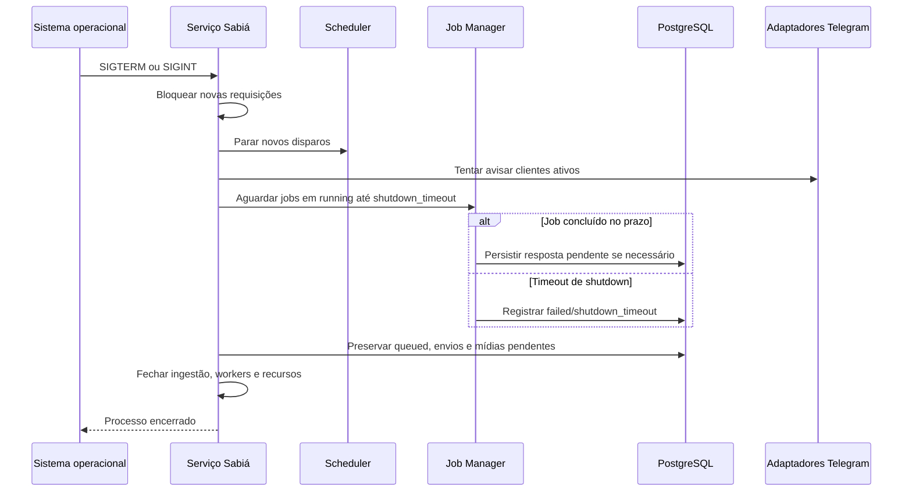

<!-- A-BIOMA-DOC-STANDARD -->
<!-- A-BIOMA-DOC-REVISADO -->

# FLUX-004 — Encerramento do serviço

**ID:** `FLUX-004` · **Origem histórica:** `FLW-0004`  
**Estado da especificação:** `refined` · **Versão aprovada:** nenhuma  
**Implementação e testes executáveis:** não verificados nesta branch.

## Objetivo

Encerrar o Sabiá de forma controlada, avisando todos os clientes Telegram ativos e preservando a entrega de respostas.

## Dependências

- [DEC-001 (ADR-0001) — Go, binário único e serviço Linux](../decisoes/DEC-001-go-binario-unico-linux.md)
- [DEC-010 (ADR-0010) — Política de encerramento de jobs](../decisoes/DEC-010-encerramento-jobs.md)
- [DEC-009 (ADR-0009) — Persistência do estado operacional](../decisoes/DEC-009-postgresql-estado-operacional.md)
- [MOD-0004 — Jobs](../arquitetura/ARQ-005-jobs.md)
- [MOD-0005 — Scheduler e Alert Manager](../especificacao/modulos/scheduler-alertas.md)
- [CONTR-006 (CTR-0006) — Mídia persistida](../contratos/CONTR-006-midia-persistida.md)
- [CONTR-007 (CTR-0007) — Transmissão persistente de mídia](../contratos/CONTR-007-transmissao-midia.md)

## Gatilho

Recebimento de `SIGTERM` ou `SIGINT`.

## Pré-condições

Serviço em execução.

## Diagrama de sequência — comportamento documentado

## Fluxo principal

1. entrar em estado de shutdown;
2. parar de aceitar novas requisições/jobs;
3. impedir novos disparos do Scheduler;
4. avisar todos os clientes Telegram ativos por seus destinos autorizados conhecidos;
5. manter os canais de saída necessários para concluir respostas já pendentes;
6. aguardar jobs em `running` até `service.shutdown_timeout`;
7. enviar toda resposta concluída ao cliente e destino que originaram a requisição;
8. manter no PostgreSQL respostas textuais que ainda não puderem ser entregues;
9. preservar no PostgreSQL mídias e transmissões `pending` ou `transmitting`;
10. preservar jobs `queued` para o próximo startup;
11. ao atingir o timeout, cancelar jobs ainda executando e registrá-los como `failed/shutdown_timeout`;
12. finalizar workers;
13. persistir estado final;
14. fechar recursos de ingestão de mídia e impedir novos uploads;
15. fechar recursos;
16. encerrar.

## Fluxos alternativos

### Falha ao avisar um cliente

Registrar a falha e continuar o shutdown. O aviso não pode impedir indefinidamente o encerramento.

### Resposta textual pronta sem entrega

Persistir como pendente para reenvio no próximo startup.

### Mídia sem confirmação

Se uma transmissão ainda não tiver confirmação do Telegram no shutdown, preservar mídia e transmissão no PostgreSQL. Ela será reconciliada e reenviada no próximo startup conforme CTR-0007.

## Falhas e tratamento

O tempo máximo é definido por `service.shutdown_timeout`. O encerramento não aguarda indefinidamente.

## Resultado

O serviço encerra sem aceitar novo trabalho, preservando fila, respostas textuais e transmissões de mídia ainda ativas.

## Critérios de aceite

- todos os clientes ativos recebem tentativa de aviso;
- respostas concluídas durante shutdown são direcionadas ao cliente correto;
- fila pendente sobrevive ao restart;
- execução que excede timeout fica registrada como falha;
- respostas textuais não entregues permanecem recuperáveis;
- mídia sem confirmação não é marcada como entregue e permanece recuperável enquanto o `media_id` existir;
- shutdown não remove BLOBs necessários a transmissões `pending` ou `transmitting`.

## Implementação relacionada

Processo principal, adaptador Telegram, Job Manager, Scheduler, workers e PostgreSQL.

## Rastreabilidade e limites

[Fonte histórica FLW-0004](../especificacao/fluxos/encerramento-servico.md). Este diagrama descreve o fluxo **proposto/documentado**; não representa execução observada. Contratos, restrições e fluxos alternativos originais foram preservados na revisão.
