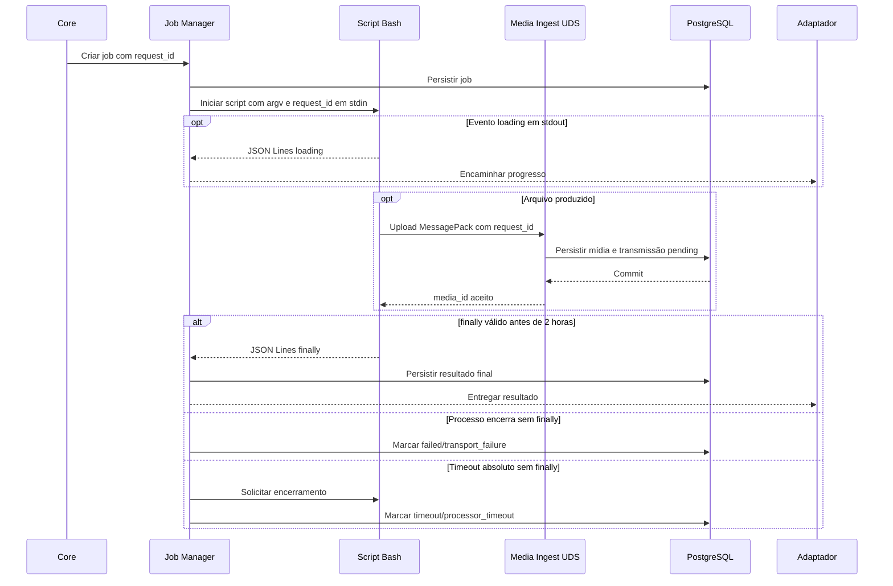

<!-- A-BIOMA-DOC-STANDARD -->
<!-- A-BIOMA-DOC-REVISADO -->

# FLUX-005 — Processamento assíncrono por processador registrado

**ID:** `FLUX-005` · **Origem histórica:** `FLW-0005`  
**Estado da especificação:** `refined` · **Versão aprovada:** nenhuma  
**Implementação e testes executáveis:** não verificados nesta branch.

## Objetivo

Executar um comando em processador assíncrono registrado, encaminhar progresso ao cliente e correlacionar mídia persistida produzida durante a execução.

## Dependências

- [MOD-0007 — Processadores assíncronos e transporte](../arquitetura/ARQ-007-processadores-assincronos.md)
- [MOD-0008 — Ingestão e armazenamento de mídia](../arquitetura/ARQ-010-ingestao-midia.md)
- [MOD-0004 — Jobs](../arquitetura/ARQ-005-jobs.md)
- [CONTR-005 (CTR-0005) — Protocolo de processador assíncrono](../contratos/CONTR-005-processador-assincrono.md)
- [CONTR-006 (CTR-0006) — Mídia persistida](../contratos/CONTR-006-midia-persistida.md)
- [CONTR-007 (CTR-0007) — Transmissão persistente de mídia](../contratos/CONTR-007-transmissao-midia.md)
- [CONTR-008 (CTR-0008) — Ingestão de mídia por Unix socket e MessagePack](../contratos/CONTR-008-ingestao-midia-messagepack.md)
- [CONTR-001 (CTR-0001) — Comando interno](../contratos/CONTR-001-comando-interno.md)

## Gatilho

Command Router resolve uma operação cadastrada como processamento assíncrono.

## Pré-condições

- operação autorizada;
- processador cadastrado;
- `request_id`, `client_id` e `reply_context` disponíveis;
- capacidade de job disponível.

## Diagrama de sequência — comportamento documentado

## Fluxo principal

1. o Sabiá cria/persiste o job e associa o `request_id`;
2. o Processor Registry resolve o `script_id` cadastrado e o Script Registry devolve a definição do script Bash;
3. o Sabiá inicia o script com os argumentos validados da operação via argv;
4. o Sabiá escreve o `request_id` UUID v4 no stdin como uma única linha e inicia o timeout absoluto de 2 horas;
5. a cada linha JSON válida emitida no stdout com evento `loading`, o Sabiá valida o `request_id` e encaminha a mensagem ao cliente;
6. quando o processador produzir mídia, ele abre o socket CTR-0008 e envia um objeto MessagePack usando o mesmo `request_id`;
7. o Media Ingest persiste BLOB e metadados, cria a transmissão `pending` e retorna `media_id`;
8. a fila de mídia pode iniciar a entrega independentemente do canal de controle;
9. o processador pode repetir o upload para cada arquivo produzido;
10. o job permanece em execução;
11. o script escreve no stdout uma linha JSON com `finally` e a mensagem final;
12. o Sabiá persiste a resposta final;
13. o adaptador envia a mensagem final;
14. as transmissões de mídia seguem CTR-0007 até `delivered` ou `failed`.

## Fluxos alternativos

### loading repetido

Cada mensagem válida pode atualizar o cliente sem encerrar o job.

### vários arquivos

Cada arquivo é um upload independente CTR-0008. Todos podem usar o mesmo `request_id` e recebem `media_id` distinto.

### falha de upload de mídia

Se o upload não atingir commit, o produtor recebe erro e a mídia não é considerada aceita.

Se o commit ocorreu mas o ACK não chegou ao produtor, uma repetição pode criar outra mídia com `media_id` distinto; esse comportamento é aceito no MVP e não há deduplicação do upload.

### falha de entrega ao Telegram

A mídia já persistida continua disponível. CTR-0007 mantém a transmissão `pending` ou `transmitting` e pode reenviar após restart.

### Processo termina sem finally

Se processo, conexão ou transporte encerrar antes do timeout sem `finally`, o processamento termina em falha de transporte. O job realiza `running → failed` e registra motivo `transport_failure`; a ausência de `finally` é preservada como detalhe diagnóstico. Não é necessário aguardar o restante das 2 horas.

### Timeout sem finally

O timeout é absoluto e começa quando a requisição é entregue ao processador.

Eventos `loading` não renovam o prazo.

Ao completar 2 horas sem `finally` válido:

1. o Processor Transport solicita encerramento/cancelamento do mecanismo associado;
2. o job realiza `running → timeout`;
3. o motivo `processor_timeout` é persistido;
4. eventos tardios dessa execução são ignorados para mudança de estado.

## Falhas e tratamento

- `request_id` desconhecido no controle ou na mídia: rejeitar;
- stdout com linha não JSON ou evento incompatível com CTR-0005: registrar falha de protocolo/processamento;
- falha do Media Ingest: não confirmar o conteúdo;
- timeout sem `finally`: após 2 horas, encerrar a execução conforme CTR-0005 e marcar o job como `timeout`;
- falha de entrega externa não remove o BLOB persistido nem altera, por si só, o resultado do processamento.

## Resultado

O job possui estado final rastreável e toda mídia aceita possui `media_id` e transmissão persistente independente.

## Critérios de aceite

- `loading` chega ao cliente correto;
- `loading` não finaliza o job;
- `finally` é necessário para conclusão semântica normal;
- vários arquivos podem ser enviados pelo socket com o mesmo `request_id`;
- ACK de mídia ocorre somente após persistência;
- mídia pendente continua recuperável após restart do serviço;
- término do processo sem `finally` não é confundido com sucesso;
- `loading` não renova o timeout absoluto de 2 horas;
- timeout sem `finally` encerra o job em `timeout` com motivo `processor_timeout`;
- canal de controle não transporta BLOB;
- stdin contém somente o `request_id` por linha;
- argumentos da operação usam argv;
- stdout contém somente JSON Lines UTF-8 do protocolo CTR-0005;
- stderr permanece diagnóstico;
- somente scripts Bash são processadores assíncronos no MVP.

## Implementação relacionada

Processor Registry, Processor Transport, Media Ingest, Job Manager, PostgreSQL e adaptadores de transporte.

## Rastreabilidade e limites

[Fonte histórica FLW-0005](https://github.com/ahhvahh/a-bioma-sabia/blob/eda1c4c1546c142cfc6967db26e24f1cd0847972/docs/especificacao/fluxos/processamento-assincrono.md). Este diagrama descreve o fluxo **proposto/documentado**; não representa execução observada. Contratos, restrições e fluxos alternativos originais foram preservados na revisão.
