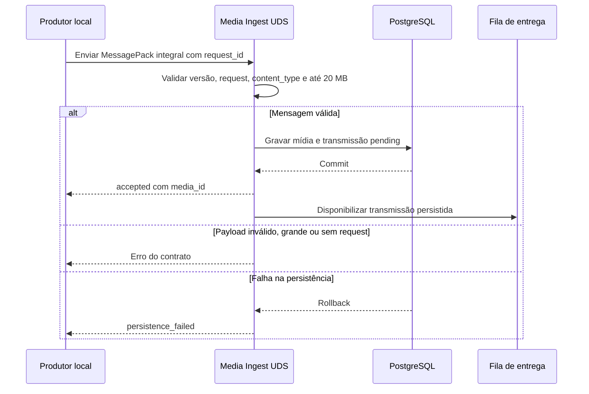

<!-- A-BIOMA-DOC-STANDARD -->
<!-- A-BIOMA-DOC-REVISADO -->

# FLUX-006 — Ingestão local de mídia

**ID:** `FLUX-006` · **Origem histórica:** `FLW-0006`  
**Estado da especificação:** `refinement` · **Versão aprovada:** nenhuma  
**Implementação e testes executáveis:** não verificados nesta branch.

## Objetivo

Receber um arquivo de um produtor local, persistir o conteúdo e prepará-lo para entrega ao cliente correlacionado.

## Dependências

- [MOD-0008 — Ingestão e armazenamento de mídia](../arquitetura/ARQ-010-ingestao-midia.md)
- [CONTR-006 (CTR-0006) — Mídia persistida](../contratos/CONTR-006-midia-persistida.md)
- [CONTR-007 (CTR-0007) — Transmissão persistente de mídia](../contratos/CONTR-007-transmissao-midia.md)
- [CONTR-008 (CTR-0008) — Ingestão de mídia por Unix socket e MessagePack](../contratos/CONTR-008-ingestao-midia-messagepack.md)
- [CONTR-009 (CTR-0009) — Ingestão fracionada de mídia por Unix socket](../contratos/CONTR-009-ingestao-midia-fracionada.md)

## Gatilho

Produtor local conecta ao socket de mídia e envia um objeto MessagePack.

## Pré-condições

- socket em execução;
- processo local autorizado a conectar;
- mensagem usa versão suportada;
- `request_id` conhecido.

## Diagrama de sequência — comportamento documentado

## Fluxo principal

1. aceitar conexão Unix local;
2. decodificar um objeto MessagePack;
3. validar `version`, `request_id`, `name` e `data`, e normalizar/validar `content_type` conforme CTR-0006;
4. rejeitar `data` maior que `20000000` bytes com `media_too_large`;
5. consultar o estado operacional e localizar a requisição e sua correlação de resposta pelo `request_id`;
6. iniciar transação PostgreSQL;
7. persistir mídia e obter `media_id`;
8. persistir transmissão `pending` para o cliente/destino da requisição;
9. confirmar a transação;
10. responder MessagePack `accepted` com `request_id` e `media_id`;
11. disponibilizar a transmissão para a fila de entrega;
12. encerrar a conexão.

## Fluxos alternativos

### Requisição desconhecida

Responder `unknown_request` e não persistir conteúdo.

### Payload inválido

Responder `invalid_message`.

### Content type inválido

Se `content_type` não for `null` e não possuir sintaxe válida de media type, responder `invalid_content_type` e não persistir conteúdo. Valor vazio ou somente com espaços é normalizado para `null`.

### Falha de persistência

Executar rollback e responder `persistence_failed`.

### Conteúdo acima do limite

Responder `media_too_large` quando `data` exceder `20000000` bytes. A rejeição ocorre antes da transação de persistência e o produtor deve usar CTR-0009. Para arquivos de até 20 MB, CTR-0009 também é uma alternativa válida.

## Falhas e tratamento

Falha antes do commit nunca produz `accepted`.

Falha depois do commit e antes de o ACK chegar ao produtor pode levar o produtor a repetir o upload. O MVP não deduplica uploads: a repetição é aceita como nova mídia e recebe novo `media_id`.

## Resultado

Mídia e transmissão existem de forma persistente e podem sobreviver a restart do Sabiá.

## Critérios de aceite

- ACK só ocorre após commit;
- transmissão é criada junto com a mídia;
- nenhum arquivo temporário é necessário;
- vários uploads podem usar o mesmo `request_id`, inclusive com mesmo nome ou conteúdo;
- falha de conexão não corrompe registro parcialmente persistido;
- retry do produtor após perda do ACK pode criar nova mídia e isso é comportamento aceito no MVP;
- payload acima de 20 MB é recusado antes de qualquer persistência e direcionado conceitualmente ao contrato fracionado;
- `content_type` inválido é recusado, vazio vira `null` e valor válido é persistido em minúsculas sem inferência por nome ou bytes.

## Implementação relacionada

Media Ingest, PostgreSQL e Media Delivery Queue.

## Rastreabilidade e limites

[Fonte histórica FLW-0006](https://github.com/ahhvahh/a-bioma-sabia/blob/eda1c4c1546c142cfc6967db26e24f1cd0847972/docs/especificacao/fluxos/ingestao-midia.md). Este diagrama descreve comportamento **proposto/documentado** e não representa execução observada. Conteúdo técnico e exceções da origem foram mantidos na revisão.
