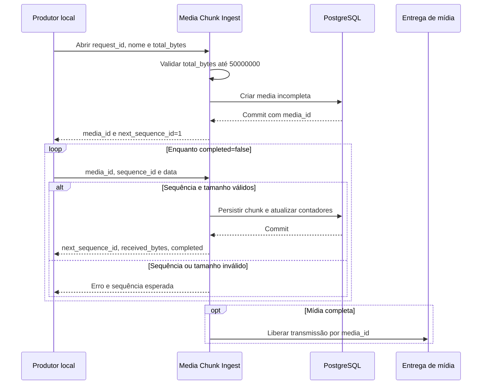

<!-- A-BIOMA-DOC-STANDARD -->
<!-- A-BIOMA-DOC-REVISADO -->

# FLUX-007 — Ingestão fracionada de mídia

**ID:** `FLUX-007` · **Origem histórica:** `FLW-0007`  
**Estado da especificação:** `refinement` · **Versão aprovada:** nenhuma  
**Implementação e testes executáveis:** não verificados nesta branch.

## Objetivo

Criar uma mídia lógica a partir dos metadados e receber seu conteúdo em chunks sequenciais persistidos individualmente.

## Dependências

- [DEC-013 (ADR-0013) — Dois canais de ingestão de mídia e upload fracionado](../decisoes/DEC-013-ingestao-midia-fracionada.md)
- [MOD-0008 — Ingestão e armazenamento de mídia](../especificacao/modulos/ingestao-midia.md)
- [CONTR-006 (CTR-0006) — Mídia persistida](../contratos/CONTR-006-midia-persistida.md)
- [CONTR-007 (CTR-0007) — Transmissão persistente de mídia](../contratos/CONTR-007-transmissao-midia.md)
- [CONTR-009 (CTR-0009) — Ingestão fracionada de mídia por Unix socket](../contratos/CONTR-009-ingestao-midia-fracionada.md)

## Gatilho

Produtor local escolhe enviar um arquivo pelo socket fracionado. Para arquivos acima de 20 MB, esse canal é obrigatório; para arquivos menores ou iguais a 20 MB, é opcional.

## Pré-condições

- socket fracionado em execução;
- processo local autorizado;
- `request_id` conhecido;
- `total_bytes > 0`; não existe tamanho mínimo para usar o fluxo.

## Diagrama de sequência — comportamento documentado

## Fluxo principal

1. produtor envia `version`, `request_id`, `name`, `content_type` e `total_bytes`;
2. Sabiá valida a requisição;
3. Sabiá valida `total_bytes` e cria a mídia com `received_bytes = 0` e `completed = false`;
4. commit gera `media_id`;
5. Sabiá responde `media_id` e `next_sequence_id = 1`;
6. produtor envia `media_id`, `sequence_id = 1` e `data`;
7. Sabiá valida tamanho e sequência;
8. calcula o novo total recebido e rejeita se ultrapassar `total_bytes`;
9. persiste o chunk, atualiza `received_bytes` e avança a próxima sequência esperada;
10. se `received_bytes == total_bytes`, marca `completed = true`;
11. responde o próximo `next_sequence_id`, `received_bytes`, `total_bytes` e `completed`;
12. produtor repete o envio enquanto `completed = false`;
13. quando `completed = true`, CTR-0007 pode iniciar sua transmissão;
14. CTR-0007 lê os chunks na sequência persistida e fornece um stream único ao adaptador.

## Fluxos alternativos

### Chunk acima de 5 MB

Responder `chunk_too_large`; não persistir.

### Mídia desconhecida

Responder `unknown_media`.

### Sequência pulada

Se o produtor enviar sequência maior que a esperada:

- não persistir;
- responder `sequence_gap`;
- informar `expected_sequence_id`.

### Sequência repetida

Se o produtor enviar sequência inferior à esperada:

- não persistir novamente;
- responder `sequence_already_received`;
- informar `expected_sequence_id`.

### Total excedido

Se um chunk faria o total persistido ultrapassar `total_bytes`:

- não persistir;
- responder `total_bytes_exceeded`;
- manter `received_bytes` e `next_sequence_id` inalterados.

### Restart

O banco preserva `media_id`, chunks confirmados e a próxima sequência esperada.

Após restart, o produtor pode continuar a partir da sequência indicada pelo estado persistido.

## Falhas e tratamento

Falha antes do commit não produz ACK.

A sequência nunca avança antes da persistência do chunk.

Falha de entrega ao Telegram não remove os chunks necessários ao recovery.

## Resultado

Um único `media_id` identifica todos os chunks do arquivo, independentemente do nome ou de outros arquivos associados à mesma requisição.

## Atualização posterior do limite — pendência histórica tratada

Na fonte histórica, o limite total ainda aparecia como `BLOCKED`. A especificação posterior [CONTR-009](../contratos/CONTR-009-ingestao-midia-fracionada.md) fixa `total_bytes <= 50000000` bytes (50 MB decimais); rejeitar a abertura acima desse valor antes de gerar `media_id`. O estado geral deste fluxo permanece `refinement`, pois esta revisão não demonstra implementação, aprovação ou resolução dos demais bloqueios do contrato.

## Critérios de aceite

- abertura cria `media_id`;
- primeira sequência esperada é 1;
- ACK de chunk informa a próxima sequência;
- sequência pulada é recusada com valor esperado;
- sequência já recebida é recusada sem duplicar conteúdo;
- `completed` ocorre automaticamente quando `received_bytes == total_bytes`;
- não existe mensagem separada de finalização;
- restart preserva progresso;
- arquivo pode ser lido sequencialmente sem materialização integral em memória.

## Implementação relacionada

Media Chunk Ingest, PostgreSQL, Media Store e Media Delivery Queue.

## Rastreabilidade e limites

[Fonte histórica FLW-0007](../especificacao/fluxos/ingestao-midia-fracionada.md). Este diagrama descreve comportamento **proposto/documentado** e não representa execução observada. Conteúdo técnico e exceções da origem foram mantidos na revisão.

**Precisão de versão:** o limite de 50 MB é posterior à origem `FLW-0007`; não implica que os demais itens em `refinement` estejam aprovados.
