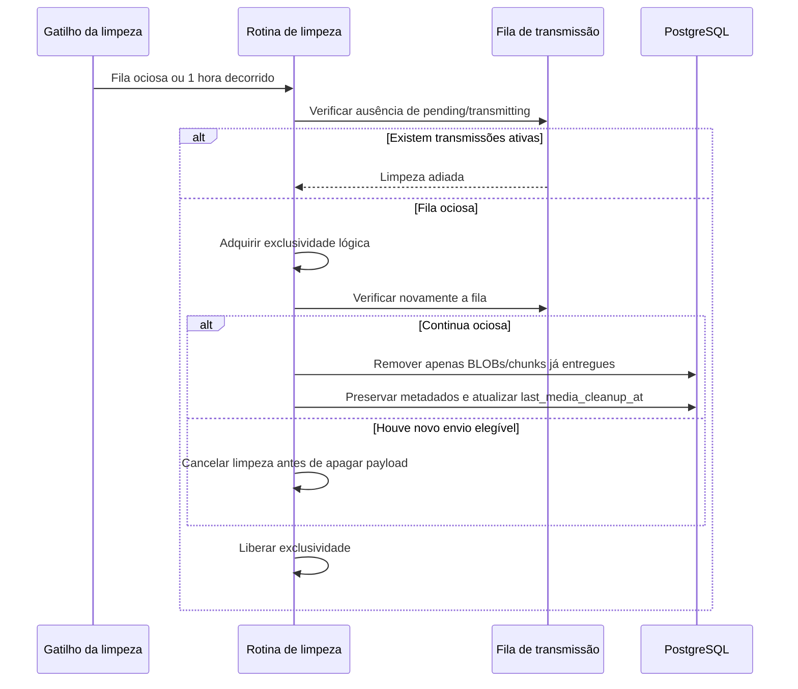

<!-- A-BIOMA-DOC-STANDARD -->
<!-- A-BIOMA-DOC-REVISADO -->

# FLUX-008 — Limpeza de payloads de mídia transmitida

**ID:** `FLUX-008` · **Origem histórica:** `FLW-0008`  
**Estado da especificação:** `refined` · **Versão aprovada:** nenhuma  
**Implementação e testes executáveis:** não verificados nesta branch.

## Objetivo

Remover do PostgreSQL conteúdos binários já entregues sem interferir em transmissões pendentes, em andamento ou recuperáveis após restart.

## Dependências

- [CONTR-006 (CTR-0006) — Mídia persistida](../contratos/CONTR-006-midia-persistida.md)
- [CONTR-007 (CTR-0007) — Transmissão persistente de mídia](../contratos/CONTR-007-transmissao-midia.md)
- [MOD-0008 — Ingestão e armazenamento de mídia](../especificacao/modulos/ingestao-midia.md)

## Gatilhos

A elegibilidade para limpeza é verificada quando ocorrer pelo menos um dos eventos:

1. a fila deixa de possuir transmissões `pending` ou `transmitting`;
2. completa-se 1 hora desde a última limpeza concluída.

O intervalo de 1 hora é fixo no MVP.

## Pré-condição obrigatória

A limpeza só pode iniciar quando não existir nenhuma transmissão em:

- `pending`;
- `transmitting`.

Se o gatilho de 1 hora ocorrer enquanto houver transmissão ativa ou pendente, a limpeza é adiada.

Quando a fila voltar a ficar sem transmissões ativas, a limpeza volta a ser elegível.

## Diagrama de sequência — comportamento documentado

## Fluxo principal

1. verificar a inexistência de transmissões `pending` e `transmitting`;
2. adquirir exclusividade lógica da rotina de limpeza;
3. verificar novamente que nenhuma transmissão ficou ativa;
4. localizar mídias cujas transmissões necessárias estejam em `delivered`;
5. para mídia `inline`, remover o BLOB `data`;
6. para mídia `chunked`, remover todos os registros de chunks;
7. preservar o registro de mídia e os metadados mínimos de rastreabilidade;
8. preservar registros de transmissão e sua confirmação remota;
9. persistir `last_media_cleanup_at`;
10. liberar a exclusividade da rotina.

## Concorrência

Enquanto a limpeza estiver executando, nenhuma transmissão de mídia pode iniciar.

Se uma transmissão se tornar elegível entre a primeira verificação e a aquisição da exclusividade, a limpeza deve ser cancelada antes de apagar qualquer payload.

A implementação precisa serializar a entrada da limpeza com a ativação de transmissões.

## Integridade referencial

Os chunks são removidos explicitamente pelo fluxo de limpeza. A relação `media_chunk.media_id → media.media_id` usa `ON DELETE RESTRICT`; não existe remoção por `CASCADE`.

Este fluxo remove payloads binários e preserva os registros de mídia e transmissão, portanto não depende de exclusão do registro pai para limpar chunks.

## Dados removidos

A rotina pode remover somente conteúdo binário já entregue:

- BLOB inline;
- chunks de mídia fracionada.

## Dados preservados

Permanecem no banco:

- `media_id`;
- `request_id`;
- nome;
- `content_type`;
- `total_bytes`;
- modo de armazenamento;
- timestamps necessários;
- estado de mídia;
- registros de transmissão;
- `remote_message_id`;
- erros e metadados operacionais que não sejam o payload binário.

## Falhas e tratamento

Se a limpeza falhar parcialmente:

- registrar a falha sem conteúdo binário;
- não alterar transmissões já entregues;
- uma execução futura pode tentar remover novamente os payloads remanescentes.

A ausência de um chunk ou BLOB já elegível à limpeza não é erro de transmissão.

## Resultado

O banco deixa de reter payload binário desnecessário depois da entrega, sem comprometer retries ou transmissões em andamento.

## Critérios de aceite

- limpeza nunca executa com transmissão `pending` ou `transmitting`;
- fila ociosa torna a limpeza elegível imediatamente;
- 1 hora desde a última limpeza torna a rotina elegível, mas não supera a pré-condição de fila ociosa;
- payload de transmissão ainda não confirmada nunca é removido;
- chunks entregues podem ser removidos;
- metadados e confirmação da transmissão permanecem rastreáveis;
- `last_media_cleanup_at` é atualizado após limpeza concluída.

## Implementação relacionada

Media Store, Media Delivery Queue e estado operacional PostgreSQL.

## Rastreabilidade e limites

[Fonte histórica FLW-0008](../especificacao/fluxos/limpeza-midia.md). Este diagrama descreve comportamento **proposto/documentado** e não representa execução observada. Conteúdo técnico e exceções da origem foram mantidos na revisão.
