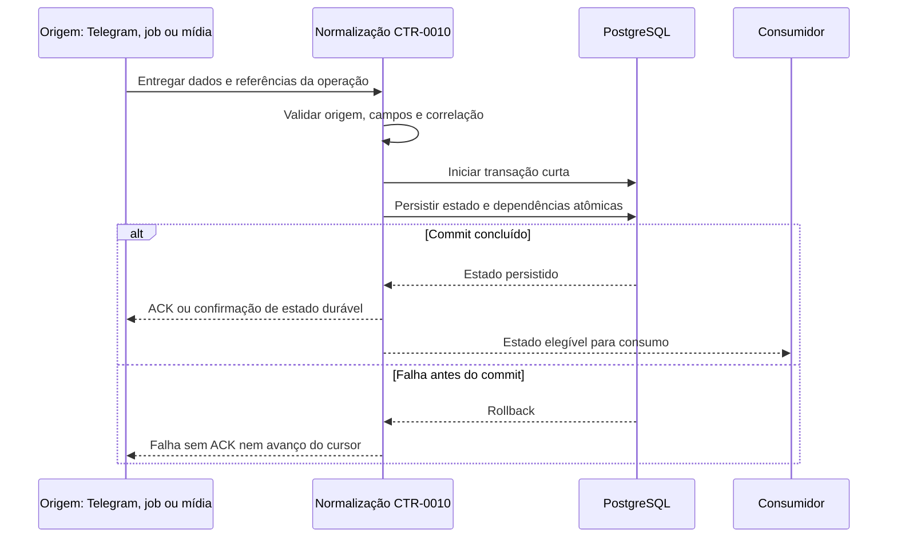

<!-- A-BIOMA-DOC-STANDARD -->
<!-- A-BIOMA-DOC-REVISADO -->

# FLUX-009 — Registro do estado operacional

**ID:** `FLUX-009` · **Origem histórica:** `FLW-0009`  
**Estado da especificação:** `refinement` · **Versão aprovada:** nenhuma  
**Implementação e testes executáveis:** não verificados nesta branch.

## Objetivo

Definir o fluxo comum para converter uma informação de origem em estado PostgreSQL durável sem perder as garantias específicas de Telegram, jobs, mídia e alertas.

## Dependências

- [CONTR-010 (CTR-0010) — Origem e conversão](../contratos/CONTR-010-origem-dados-persistencia.md)
- [PST-0100 — Entidades persistentes](../persistencia/entidades/README.md)
- [PST-0002 — Relacionamentos](../persistencia/relacionamentos.md)

## Gatilhos

- update recebido do Telegram;
- criação/transição de job;
- resposta textual produzida;
- avaliação de alerta;
- upload integral por CTR-0008;
- abertura/chunk por CTR-0009;
- mudança de estado de transmissão.

## Entradas e pré-condições

A entrada pode vir de update Telegram, job, resposta, alerta, mídia ou transição de entrega. A origem deve fornecer os campos exigidos por seu contrato; somente dados validados podem ser confirmados como duráveis.

## Diagrama de sequência — comportamento documentado

## Fluxo principal

1. identificar a origem;
2. validar autorização da origem quando aplicável;
3. extrair somente campos definidos pelo contrato da origem;
4. normalizar por CTR-0010;
5. validar referências já persistidas necessárias;
6. calcular campos derivados;
7. iniciar transação curta;
8. gravar entidade principal e dependências que exigem atomicidade conjunta;
9. validar restrições/estado antes do commit;
10. commit;
11. somente depois emitir ACK, avançar cursor ou expor estado como durável.

## Regras específicas

### Telegram

`inbound_update` e avanço de `transport_cursor` pertencem à mesma unidade transacional. O offset remoto só pode avançar depois do commit.

### Requisição

A criação da `request` gera um `request_id` UUID v4 no Sabiá e persiste o estado inicial `received`. Antes de entregar a requisição ao Core, o estado muda para `processing`.

Quando o Core produz seu resultado imediato, a request muda para `completed`. Resultado imediato inclui a criação persistida de um job assíncrono; a conclusão futura do job não altera `request.status`.

Erro controlado ou falha do processamento pelo Core muda a request para `failed`.

Estados de entrega de mensagem e mídia não alteram `request.status`.

### Entrada no processo de limpeza

Quando a tarefa associada à correlação termina, o conjunto identificado pelo `request_id` torna-se elegível para limpeza.

A elegibilidade não implica exclusão imediata. Antes de remover metadados de correlação, o processo de limpeza deve verificar que não existem jobs não terminais, mensagens `pending/sending` ou transmissões de mídia `pending/transmitting` ligadas ao mesmo `request_id`.

O prazo de retenção dos registros concluídos permanece fora deste fluxo até ser definido.

### Purge explícito

O processo de limpeza não usa exclusão em cascata.

Quando uma correlação estiver elegível e a política de retenção permitir o purge, a aplicação deve remover explicitamente os registros dependentes em ordem compatível com PST-0002. A `request` é removida por último.

Todas as FKs operacionais usam `ON DELETE RESTRICT`; se alguma dependência ainda existir, a exclusão do pai falha e o purge não pode forçar remoção por `CASCADE` ou `SET NULL`.

### Job

Mudança de `job.status` e inserção em `job_state_history` pertencem à mesma transação.

### Resposta textual

A resposta é criada em `pending` antes do envio. O claim de PST-0003 persiste `pending → sending` antes da chamada externa. Confirmação remota e `delivered` são persistidas juntas; falha temporária retorna a mensagem para `pending`.

### Mídia integral

`media` e `media_transmission` são persistidas antes do ACK CTR-0008.

### Chunk

`media_chunk` e os contadores/estado da `media` são atualizados na mesma transação.

### Alertas

O novo estado deve ser durável para sobreviver a restart. A regra exata de atualização de `last_notified_at` permanece BLOCKED em PST-0107.

## Falhas

Falha antes do commit:

- não emitir sucesso;
- não avançar cursor;
- não avançar sequência;
- não marcar entrega como confirmada.

Falha depois do commit, antes do ACK:

- o estado persistido permanece fonte da verdade;
- regras de idempotência/retry do contrato específico são aplicadas.

## Resultado

Estado operacional durável e rastreável no PostgreSQL.

## BLOCKED

Este fluxo não pode atingir `refined` antes dos pontos BLOCKED de CTR-0010 e das entidades diretamente afetadas.

## Rastreabilidade e limites

[Fonte histórica FLW-0009](../especificacao/fluxos/registro-estado-operacional.md). Este diagrama descreve comportamento **proposto/documentado** e não representa execução observada. Conteúdo técnico e exceções da origem foram mantidos na revisão.
