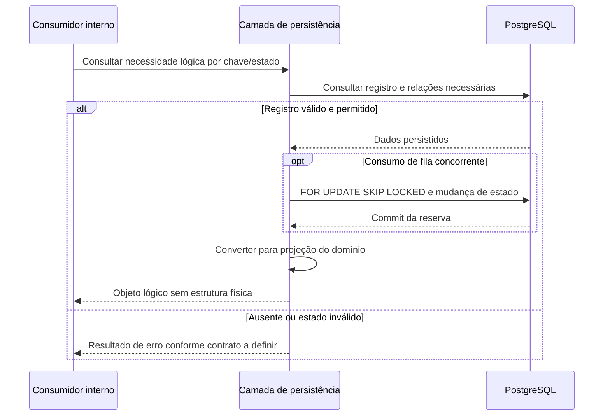

<!-- A-BIOMA-DOC-STANDARD -->
<!-- A-BIOMA-DOC-REVISADO -->

# FLUX-010 — Consumo do estado operacional

**ID:** `FLUX-010` · **Origem histórica:** `FLW-0010`  
**Estado da especificação:** `refinement` · **Versão aprovada:** nenhuma  
**Implementação e testes executáveis:** não verificados nesta branch.

## Objetivo

Definir como componentes consultam o PostgreSQL e convertem registros persistidos em objetos/ações internas sem expor estrutura física do banco como contrato de domínio.

## Dependências

- [CONTR-010 (CTR-0010) — Origem e conversão](../contratos/CONTR-010-origem-dados-persistencia.md)
- [PST-0100 — Entidades persistentes](../persistencia/entidades/README.md)
- [CONTR-003 (CTR-0003) — Job](../contratos/CONTR-003-job.md)
- [CONTR-007 (CTR-0007) — Transmissão de mídia](../contratos/CONTR-007-transmissao-midia.md)
- [PST-0003 — Claim concorrente de filas persistentes](../persistencia/concorrencia.md)

## Princípio

A tabela é fonte persistente de estado, mas o consumidor recebe uma projeção compatível com seu contrato.

Exemplos:

- Job Manager consome uma projeção de `job`;
- Telegram Adapter consome uma projeção de `outbound_message`;
- Media Delivery Queue consome `media_transmission + media`;
- Alert Manager consome `alert_state`;
- CTR-0008/CTR-0009 consultam `request` para validar correlação.

## Entradas e pré-condições

O consumidor informa uma necessidade lógica e chave/estado da projeção. O registro deve existir e estar em estado permitido; claims concorrentes exigem transação curta antes do processamento externo.

## Diagrama de sequência — comportamento documentado

## Fluxo principal

1. consumidor declara a necessidade lógica;
2. camada de persistência executa consulta por chave/estado;
3. validar que o registro existe e está em estado permitido;
4. carregar somente relações necessárias;
5. converter tipos PostgreSQL para tipos internos do contrato;
6. devolver projeção lógica ao consumidor;
7. alterações posteriores voltam ao fluxo FLW-0009.

## Projeções mínimas

### Validar `request_id` para socket

Entrada: `request_id`.

Saída mínima:

- existência;
- `request_id`;
- `client_id`;
- `transport`;
- `destination_id`.

Esses dados permitem criar `media_transmission` sem aceitar destino fornecido pelo produtor.

### Obter próximo job

Filtro: `job.status = queued`.

Saída: campos necessários a CTR-0003 e à operação registrada.

O consumo ocorre exclusivamente pelo claim atômico de PST-0003. A rotina seleciona `queued` com `FOR UPDATE SKIP LOCKED`, muda o job para `running`, registra o histórico correspondente e faz commit antes de devolver o item ao worker.

### Recuperar respostas pendentes

Filtro lógico:

- `status = pending`;
- `available_at IS NULL OR available_at <= agora`.

Saída: cliente, transporte, destino e conteúdo.

O entregador recebe `content` como texto já materializado pelo adaptador; recovery não reconstrói o envelope CTR-0001.

A mensagem deve ser reclamada conforme PST-0003, realizando `pending → sending` na mesma transação do claim antes de qualquer chamada ao transporte.

### Recuperar transmissão de mídia

Filtro: `pending` ou `transmitting` elegível.

Carregar:

- `media_transmission`;
- `media`;
- se `storage_mode = chunked`, stream de `media_chunk` em ordem.

Para uma nova tentativa elegível em `pending`, o claim realiza `pending → transmitting` conforme PST-0003 antes do streaming.

### Recuperar estado de alerta

Chave: `schedule_id`.

Saída:

- estado anterior;
- `last_evaluated_at`;
- `last_notified_at`.

Ausência significa primeira avaliação conforme FLW-0003.

### Recuperar cursor Telegram

Chave: `client_id + transport`.

Saída: `last_update_id`; o adaptador calcula o próximo offset.

## Conversões PostgreSQL → domínio

- `text` de IDs opacos permanece string;
- PostgreSQL `uuid` de `request_id` é projetado nos contratos como string UUID canônica;
- `timestamptz` torna-se instante absoluto;
- `text[]` torna-se lista ordenada de strings;
- `bytea` é exposto apenas ao componente autorizado a consumir mídia;
- valores de estado precisam ser validados contra o domínio do contrato correspondente;
- linhas físicas não são entregues diretamente a adaptadores externos.

## Concorrência

O claim concorrente é definido por PST-0003. Jobs, mensagens de saída e transmissões de mídia são reservados no PostgreSQL com transação curta, `FOR UPDATE SKIP LOCKED` e mudança de estado antes do commit. O processamento externo ocorre somente depois do commit.

## BLOCKED

- comportamento quando dados persistidos violarem um domínio esperado após migração ou inconsistência.

## Critérios de aceite

- consumidores não precisam conhecer objetos do transporte de origem;
- socket recupera destino somente a partir da request persistida;
- recovery usa o mesmo estado persistido usado em operação normal;
- mídia chunked é consumida em sequência sem montagem integral obrigatória;
- toda alteração decorrente do consumo retorna ao fluxo FLW-0009;
- consumidores concorrentes não recebem o mesmo item elegível pelo mesmo estado de fila.

## Rastreabilidade e limites

[Fonte histórica FLW-0010](../especificacao/fluxos/consumo-estado-operacional.md). Este diagrama descreve comportamento **proposto/documentado** e não representa execução observada. Conteúdo técnico e exceções da origem foram mantidos na revisão.
