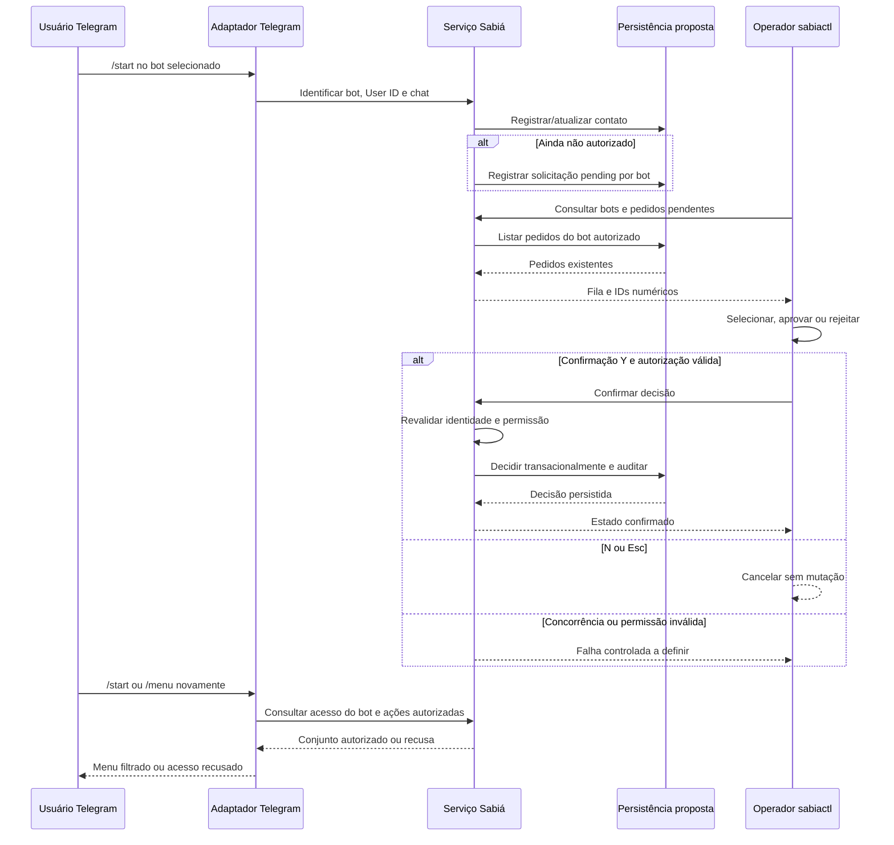

<!-- A-BIOMA-DOC-STANDARD -->
<!-- A-BIOMA-DOC-REVISADO -->

# FLUX-011 — Cadastro de contato e aprovação de acesso por bot

**Estado:** `refinement` — fluxo **proposto**. **Versão aprovada:** nenhuma. **Implementação e testes:** não verificados.

## Objetivo e gatilho

Descrever o fluxo documentado de `/start` até a decisão humana sobre acesso a um bot. A solicitação **não é** `chat_join_request` nativo do Telegram.

## Pré-condições

- Existe cliente/bot lógico com token e isolamento próprios.
- O serviço deve correlacionar `client_id`, Telegram User ID e chat; username ou nome não substituem o identificador numérico.
- O operador tem acesso ao terminal **e** autorização administrativa específica para aquele bot, não apenas filiação ao grupo Linux.

## Diagrama de sequência — intenção documentada

## Ações e estados previstos

1. Receber `/start`, identificar cliente, usuário e chat; cadastrar contato sem conceder acesso.
2. Criar solicitação interna `pending` quando não autorizado; o modelo físico em [ENT-013](../persistencia/entidades/ENT-013-telegram-access-request.md) ainda é **proposta**.
3. No `sabiactl`, selecionar **Usuários e clientes → Solicitações de acesso → Bot**, percorrer com `↑`/`↓`; `→` prepara aprovação, `←` rejeição.
4. Exibir bot, nome e ID numérico antes da decisão; `Y` confirma, `N`/`Esc` cancela sem alterações.
5. Revalidar acesso e transação no serviço, registrar operador/data, impedir perda do histórico na rejeição, limitar aprovação àquele bot.
6. Refiltrar ações a cada solicitação de menu. Contato conhecido **não** equivale a usuário autorizado.

## Exceções e pendências

- Conflito entre dois operadores, reenvio após rejeição, política de recuperação e paginação de pedidos ainda exigem definição de contrato.
- A precedência entre whitelist YAML com reinício e autorizações PostgreSQL dinâmicas **não está resolvida**.
- Este diagrama mostra a intenção de persistência; não pressupõe tabelas criadas nem confirmações remotas implementadas.

## Fontes e dependências

- [Consolidado histórico — seção 3](../regras-consolidadas-sabia.md)
- [CONTR-011 — API administrativa planejada](../contratos/CONTR-011-api-administrativa-uds.md)
- [ENT-012 — Contato](../persistencia/entidades/ENT-012-telegram-contact.md)
- [ENT-013 — Solicitação](../persistencia/entidades/ENT-013-telegram-access-request.md)
- [ENT-014 — Autorização](../persistencia/entidades/ENT-014-telegram-authorization.md)
- [FLUX-001 — Comando Telegram](FLUX-001-comando-telegram.md)
