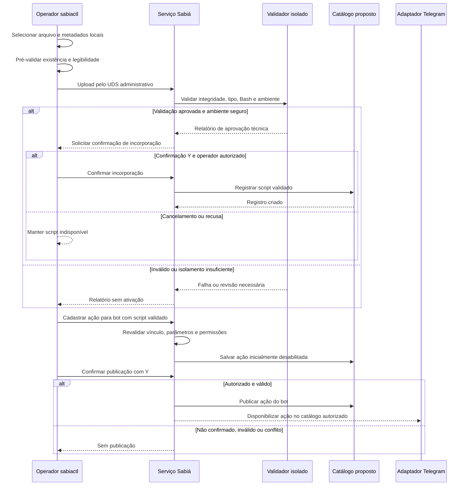

<!-- A-BIOMA-DOC-STANDARD -->
<!-- A-BIOMA-DOC-REVISADO -->

# FLUX-012 — Validação, incorporação e publicação de scripts e ações

**Estado:** `refinement` — fluxo de administração **proposto**. **Versão aprovada:** nenhuma. **Implementação e testes:** não verificados.

## Objetivo e pré-condições

Separar **arquivo enviado**, **script validado/incorporado** e **ação publicada no Telegram**, sem permitir execução arbitrária. O operador deve ter autorização para o bot/ação envolvidos e conectar-se ao serviço somente pela API administrativa UDS.

## Diagrama de sequência — intenção documentada

## Passos e restrições

1. Selecionar em `sabiactl` **Scripts → Enviar novo script**, fornecer arquivo **local** e identificador lógico, descrição, tipo, modo e ambiente pretendido.
2. Pré-validar arquivo regular, tamanho, leitura e metadados; somente então enviar para **área de validação isolada** do serviço. Upload não implica instalação, incorporação ou execução.
3. Verificar integridade, tipo, interpretador, sintaxe (por exemplo `bash -n`) e ambiente. Testes dinâmicos, quando exigidos, precisam de **isolamento sem segredos ou privilégios do daemon**; `bash -n` sozinho não prova segurança.
4. Exibir relatório. Após resultado satisfatório, exigir confirmação `Y` e autorização para incorporar. Manter rejeitados indisponíveis para execução/vínculo.
5. Para publicar ação, selecionar **Menus e ações → Selecionar bot → Nova ação**; fornecer identificador, rótulo, caminho lógico do menu, `script_id` validado, modo, parâmetros aceitos e permissões.
6. Validar o vínculo ao script e ao bot. A ação inicia desabilitada/rascunho; publicar somente após confirmação `Y` e revalidação no serviço.
7. O menu por `/start` ou `/menu` exibe apenas operações permitidas. O clique usa Command Router, **nunca** executa caminho arbitrário fornecido pelo usuário.

## Integração com execução já documentada

Uma vez cadastrado, o executor resolve `script_id` pela definição permitida; usa caminhos absolutos autorizados, `argv` validado, ambiente explicitamente controlado e **não invoca `sh -c` ou `bash -c` automaticamente**. O MVP limita `stdout` e `stderr` convencionais a **1 MiB por canal**. [CONTR-002](../contratos/CONTR-002-execucao-script.md) é a fonte técnica para execução, não para upload administrativo.

## Bloqueios e falhas

Caminho/framing do UDS administrativo, upload e armazenamento, tamanho permitido, identidade e versionamento do script, política de isolamento para testes, auditoria, autorização por bot, concorrência, erros e precedência entre YAML e catálogo persistente **ainda requerem decisão**. Os registros em [ENT-015](../persistencia/entidades/ENT-015-script-registry.md) e [ENT-016](../persistencia/entidades/ENT-016-action-catalog.md) são propostas; a execução deste fluxo não foi verificada.

## Rastreabilidade

- [Consolidado histórico — seção 4](../regras-consolidadas-sabia.md)
- [CONTR-011 — API administrativa](../contratos/CONTR-011-api-administrativa-uds.md)
- [ARQ-004 — Registro de scripts](../arquitetura/ARQ-004-registro-execucao-scripts.md)
- [Terminal `sabiactl`](../interfaces/terminal/INTF-TERM-001-sabiactl.md)
- [Catálogo de ações proposto](../persistencia/entidades/ENT-016-action-catalog.md)
