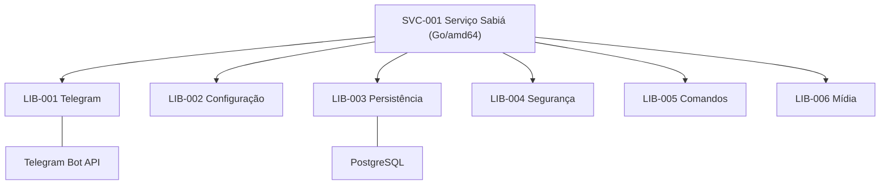

# Sabiá — Implementation
  

Estrutura documental **proposta**, aprovada para Debian Linux `amd64` com linguagem recomendada Go, binário único `sabia` e supervisão systemd.

- [Serviço](services/README.md)
- [Bibliotecas](libraries/README.md)
- [Charter legado](../01-Project_Charter/charter/README.md)
- [Scope legado](../01-Project_Charter/scope/README.md)
- [Pendências documentais](../pendencias.md)
- [Contrato operacional Telegram](../telegram-operacao-2026.md)
- [Testes de referência T01–T05](../testes/telegram/README.md)

## Unidades

**BLOCKED — Gate Scope → Implementation:** os Charter/Scope usados por estas unidades seguem em `refinement`; portanto esta organização é **PROPOSED**, não `refined` e muito menos `implemented`. TYPEs, ALG, interfaces, modelos físicos, migrações e dependências externas ficam `PENDING` nos arquivos das unidades. Não criar código `/src` com base nesta estrutura sem refinar as origens.

**PENDING visual:** não existem badges SVG locais sob `/docs/assets` no Sabiá; os badges destas propostas usam o catálogo original imutável da norma, até sua instalação autorizada no caminho canônico.

**Norma consultada:** `ahhvahh/doc-arquitetura` `main` em `652e1035a6ebb7ade0f21a6f2b9d08156ba35b37`. Sem alteração na referência.
