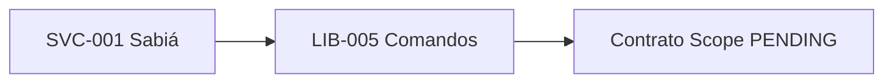
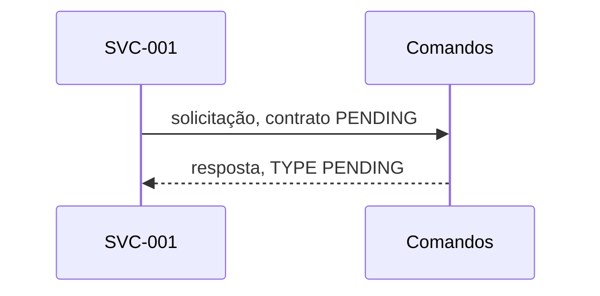

# LIB-005 — Biblioteca Comandos
  

## Responsabilidade

Roteamento de operações previamente registradas; organização dos menus hierárquicos e botões de navegação.

## Contratos de origem

- [IN-011](../../../01-Project_Charter/scope/in-scope/IN-011-catalogo-persistente-de-acoes-e-menu.md) — *refinement*.
- [FLW-007](../../../01-Project_Charter/scope/flows/FLW-007-cadastro-administrativo-e-execucao-de-acao-persistente.md) — *refinement*.
- [Regras técnicas do Sabiá](../../../telegram-operacao-2026.md) — orientação anterior; não substitui Scope refinado.

**BLOCKED:** os contratos citados não estão `refined` nem `implemented`. A unidade define uma fronteira de responsabilidade aprovada para organização, **não** contrato operacional aprovado.

## Linguagem recomendada e target

- Go, para integrar a unidade ao binário único do serviço sem runtime adicional.
- Linux `amd64` (Debian Intel/AMD 64 bits).
- Alternativas C/C++/Rust exigiriam integração FFI e build adicional; não escolhidas pelo usuário.
- As Libraries serão ligadas ao serviço, não distribuídas como processos separados.

## Contrato público e estratégia

**PENDING:** TYPEs concretos, API Go, entradas e saídas, ALGs funcionais e técnicos, dependências DEP e política final de erros dependem do refinamento de Scope. Não inventar assinaturas nem estados.

### Fluxograma proposto (composição)

### Diagrama de sequência proposto (não normativo)

## Error Handling

Ação inválida, expirada ou desconhecida não autoriza execução. Representações, códigos e retentativas permanecem `PENDING` até contratos de erro refinados.

## Observability

- Trace: detalhe técnico opcional, sem payload sensível.
- Information: eventos operacionais relevantes.
- Warning: rejeições e falhas recuperáveis.
- Error: falha que impede uma operação solicitada.
- Critical: indisponibilidade da responsabilidade essencial.

Não registrar tokens, segredos nem anexos brutos.

## Validação e dependências

Casos correlatos do [plano T01–T05](../../../testes/telegram/README.md): T02, T05. Catálogo próprio `LIB-005-Txxx`, mocks e dependências concretas `DEP-*` ainda **PENDING**. Nenhum teste foi executado.

**Gate para Development:** BLOCKED até Scope e especificação técnica serem refinados. Nenhum código `/src` foi gerado.
