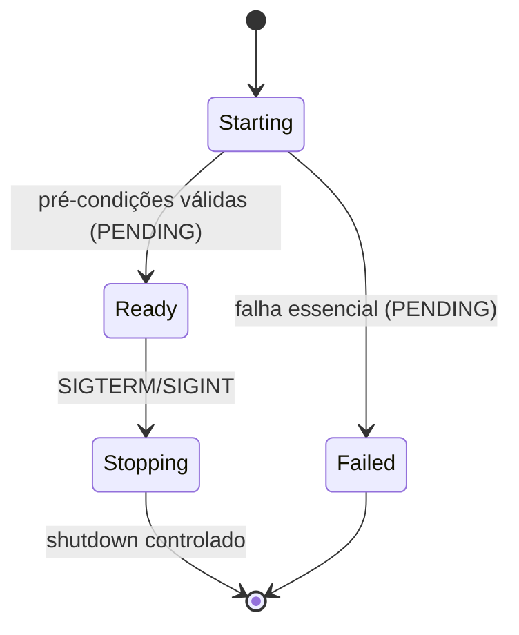

# SVC-001 — Serviço Sabiá
  

## Responsabilidade

Um processo Go de longa duração, binário `sabia` para Debian Linux `amd64`, gerenciado pelo `systemd`, compondo as seis Libraries descritas em [libraries](../../libraries/README.md).

## Origens

- [IN-009 — Operação segura como serviço Linux](../../../01-Project_Charter/scope/in-scope/IN-009-operacao-segura-como-servico-linux.md) — refinement.
- [IN-001 — Clientes Telegram](../../../01-Project_Charter/scope/in-scope/IN-001-clientes-telegram-isolados.md) — refinement.
- [FLW-005 — Inicialização e recovery](../../../01-Project_Charter/scope/flows/FLW-005-inicializacao-recovery-e-encerramento.md) — refinement.
- [INT-001 — Telegram](../../../01-Project_Charter/scope/integrations/INT-001-telegram-bot-api.md) — refinement.
- [INT-004 — PostgreSQL](../../../01-Project_Charter/scope/integrations/INT-004-postgresql.md) — refinement.

**BLOCKED:** estes documentos não estão liberados para sustentar Implementation `refined`.

## Ambiente e implantação

| Campo | Proposta/documentação vigente |
|---|---|
| Sistema e target | Debian Linux `amd64` |
| Recommended Language | Go |
| Binário | `sabia` |
| Processo | Serviço systemd |
| Identidade | Usuário dedicado `sabia`, sem root |
| Configuração | `/etc/sabia/sabia.yaml` — [CFG-0001](../../../especificacao/configuracao/modelo-configuracao.md), em refinement |
| Segredos | Referência `token_env` a credencial protegida, nunca valor literal no Git |
| PostgreSQL | Persistência oficial; schema de conexão e migração PENDING |
| Telegram | HTTPS/long polling de saída; sem webhook público no MVP |
| Sockets e filesystem | Caminhos, permissões finais e runtime dir PENDING conforme CFG-0001 |

## Libraries

- [LIB-001 — Telegram](../../libraries/LIB-001-telegram/LIB-001-telegram.md)
- [LIB-002 — Configuração](../../libraries/LIB-002-configuracao/LIB-002-configuracao.md)
- [LIB-003 — Persistência](../../libraries/LIB-003-persistencia/LIB-003-persistencia.md)
- [LIB-004 — Segurança](../../libraries/LIB-004-seguranca/LIB-004-seguranca.md)
- [LIB-005 — Comandos](../../libraries/LIB-005-comandos/LIB-005-comandos.md)
- [LIB-006 — Mídia](../../libraries/LIB-006-midia/LIB-006-midia.md)

## Matriz interface → TYPE → FLW → ALG → TYPE → Library

| Interface | Entrada | Fluxo | ALG | Saída | Library |
|---|---|---|---|---|---|
| Telegram `getUpdates` | TYPE PENDING | [FLW-001](../../../01-Project_Charter/scope/flows/FLW-001-comando-telegram.md) | PENDING | TYPE PENDING | LIB-001 |
| PostgreSQL | TYPE PENDING | [FLW-005](../../../01-Project_Charter/scope/flows/FLW-005-inicializacao-recovery-e-encerramento.md) | PENDING | TYPE PENDING | LIB-003 |

## Lifecycle técnico proposto

Os nomes dos estados abaixo ainda **não são contrato funcional refinado**. Não se adiciona execução nova àquela prevista em FLW-005.

**PENDING:** verificação exata de prontidão, comportamento de cliente degradado, parada durante jobs ativos, limites do shutdown e healthchecks conforme contratos refinados.

## Autorização, Error Handling e Observability

Execução sem root, credenciais fora de logs, autorização por cliente/usuário/chat e revalidação de callbacks já constam na documentação legada. Campos de erros controlados e auditoria permanecem PENDING.

- Trace: detalhes técnicos sem segredos.
- Information: inicialização, prontidão e encerramento.
- Warning: falhas recuperáveis e degradação explicitamente permitida.
- Error: falhas que impeçam operações.
- Critical: impossibilidade de operação segura.

## Empacotamento e validação

Unit systemd, diretórios, hardening, scripts de build próprios, instalação e versionamento `.deb`: **PENDING**. Cenários existentes [T01–T05](../../../testes/telegram/README.md) são referência para testes, não evidência de execução; catálogo SVC e `test.sh` individual ainda PENDING.

**Resultado:** `refinement`, **BLOCKED** para Development; nenhum binário ou código em `/src` nesta entrega.
