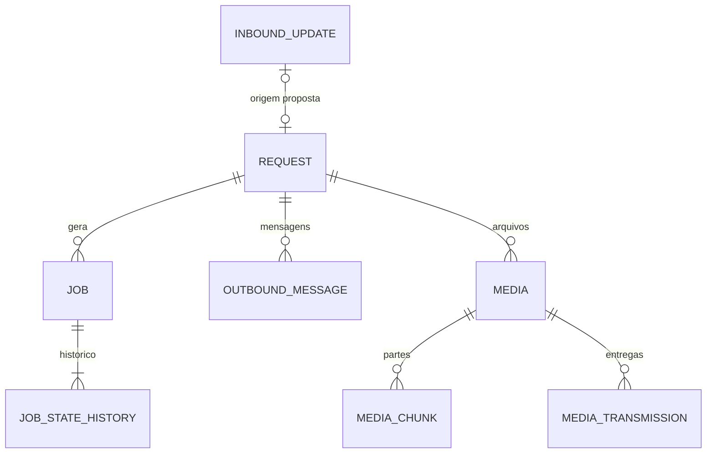

# Persistência — modelo documental

> **Modelo proposto, não banco instalado.** O PostgreSQL foi selecionado como persistência operacional; tabelas e relacionamentos permanecem em `refinement` e não há migrações executáveis nesta branch.

## Onde os dados serão guardados

O desenho prevê um banco PostgreSQL lógico próprio do Sabiá, com role exclusiva. Mensagens, correlações, filas, alertas e mídia binária ficarão no banco; a configuração do serviço será lida do YAML `/etc/sabia/sabia.yaml`, não de tabelas de configuração.

## Entidades propostas

| Entidade | Finalidade |
|---|---|
| `transport_cursor` | Último update confirmado por cliente/transporte |
| `inbound_update` | Inbox de entradas, idempotência e dados brutos recebidos |
| `request` | Requisição normalizada e correlação |
| `job` | Execuções assíncronas e seus estados |
| `job_state_history` | Histórico das transições de jobs |
| `outbound_message` | Fila de mensagens textuais para entrega |
| `alert_state` | Último estado das verificações agendadas |
| `media` | Metadados e conteúdo de arquivos |
| `media_chunk` | Partes persistidas de arquivos fracionados |
| `media_transmission` | Entregas de mídia e respectivos estados |
| `schema_version` | Versionamento de schema; mecanismo final pendente |

## Relacionamentos — visão simplificada e provisória

`transport_cursor`, `alert_state` e `schema_version` não requerem as relações físicas ilustradas acima. A direção definitiva entre `inbound_update` e `request`, a correlação dos alertas e a consistência entre mídia e transmissão **ainda estão pendentes**.

## Regras e lacunas

- O desenho prevê `ON DELETE RESTRICT` para as relações operacionais, com remoção controlada de dependências; **retenção/purge ainda não foram fechados**.
- `media.data` e `media_chunk.data` usam conteúdo binário `bytea`, conforme a proposta física.
- Registro de **contatos** e **catálogo persistente de ações** constam do Charter/Scope, mas não aparecem como entidades concluídas no índice PST-0100. Não se deve supor nomes e campos sem especificação adicional.
- Não existe banco, schema ou backup implantado comprovado pelo repositório.

**Detalhamento canônico (não duplicado aqui):** [tabelas e campos](especificacao/persistencia/tabelas-estado-operacional.md), [relacionamentos e cardinalidades](especificacao/persistencia/relacionamentos-estado-operacional.md), [fichas individuais das 11 entidades](especificacao/persistencia/entidades/README.md) e [pendências](pendencias.md).
