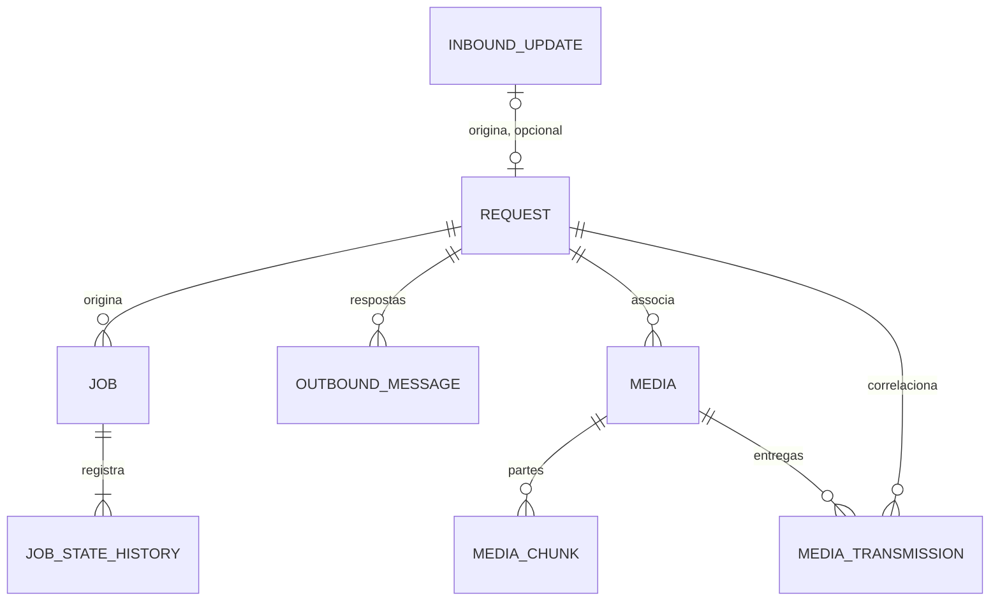
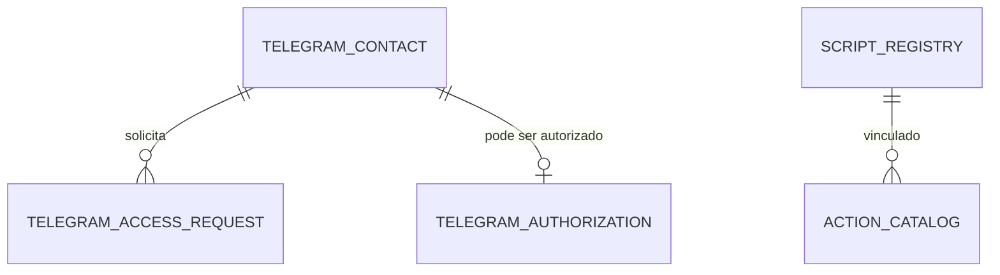

<!-- A-BIOMA-DOC-STANDARD -->
<!-- A-BIOMA-DOC-REVISADO -->

# PERS-001 — Modelo relacional PostgreSQL do Sabiá

**Situação:** modelo físico **proposto**, sem migrações ou DDL executável verificados. Banco `abioma_sabia` e schema `sabia` são nomes propostos, não provisionamento confirmado.

 

**Banco:** `abioma_sabia` · **Schema:** `sabia`. Todas as relações abaixo são **propostas físicas em revisão**; o estado de cada entidade está na respectiva [ficha](entidades/README.md).

## Diagrama relacional — núcleo operacional

`transport_cursor` usa chave lógica `(client_id, transport)`; `alert_state` referencia `schedule_id` do YAML **sem FK física**; `schema_version` é condicional.

| Origem (FK) | Destino (PK/UNIQUE) | Cardinalidade | Integridade |
|---|---|---|---|
| `request.inbound_update_id` | `inbound_update.inbound_update_id` | update 0..1 : request 0..1 | FK opcional + UNIQUE parcial ou UNIQUE nullable, **a validar** |
| `job.request_id` | `request.request_id` | request 1 : N jobs | FK RESTRICT |
| `job_state_history.job_id` | `job.job_id` | job 1 : N históricos | FK RESTRICT |
| `outbound_message.request_id` | `request.request_id` | request 1 : N mensagens | FK RESTRICT; alertas sem request seguem bloqueados |
| `media.request_id` | `request.request_id` | request 1 : N mídias | FK RESTRICT |
| `media_chunk.media_id` | `media.media_id` | media 1 : N chunks | FK RESTRICT; `(media_id, sequence_id)` PK |
| `media_transmission.media_id` | `media.media_id` | media 1 : N entregas | FK RESTRICT |
| `media_transmission.request_id` | `request.request_id` | request 1 : N entregas | FK RESTRICT; coerência com media pendente |

**Pontos que exigem decisão antes do DDL:** remover `inbound_update.request_id` redundante se a FK ficar em `request`; garantir `media_transmission.request_id = media.request_id` por banco ou aplicação; correlacionar mensagens do Scheduler sem `request` original. Historizações e baixa de dependências devem ocorrer sem `ON DELETE CASCADE`.

## Diagrama das novas propostas administrativas (não aprovadas)

`telegram_contact`, `telegram_access_request`, `telegram_authorization`, `script_registry` e `action_catalog` **não constavam** no PST-0100 original. São propostas documentais para requisitos já descritos de cadastro `/start`, aprovação manual e catálogo por bot. Os identificadores `client_id` não são FKs para uma tabela de bot aprovada: a configuração de clientes ainda reside em YAML. Ver [pendências](PERS-002-pendencias-modelo-fisico.md).

## Regras transacionais

- Persistir `inbound_update.raw_update` e avançar `transport_cursor` **na mesma transação** antes de confirmar offset.
- Gravar `job` + estado inicial no histórico na mesma transação; cada mudança de estado atualiza job + insere histórico atomicamente.
- Inserir chunk + atualizar contadores de mídia na mesma transação; ACK somente após commit.
- Reservar jobs e entregas com `FOR UPDATE SKIP LOCKED` em transação curta; não segurar lock durante processamento remoto.
- Confirmar envio de mensagem e `remote_message_id` na mesma transação.
- Não excluir pais enquanto houver filhos ativos; limpeza e retenção seguem pendentes.

**Detalhamento:** [entidades](entidades/README.md), [concorrência](concorrencia.md), [integridade pendente](PERS-002-pendencias-modelo-fisico.md).

## Rastreabilidade e limites da revisão

Fonte integral preservada: [Relacionamentos das entidades — PostgreSQL](relacionamentos.md). A revisão atualizou a navegação e explicitou o caráter proposto do modelo; não houve instalação nem execução de testes.
